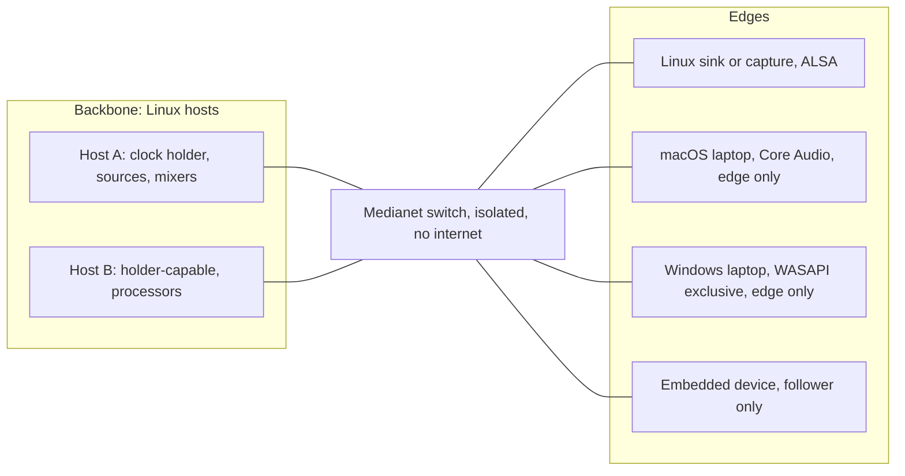
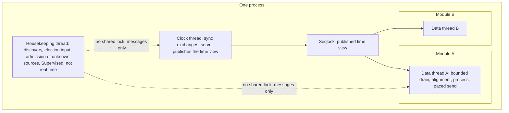
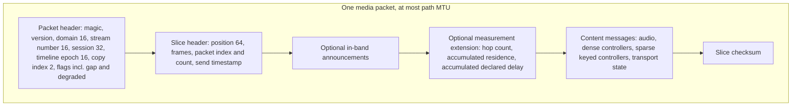
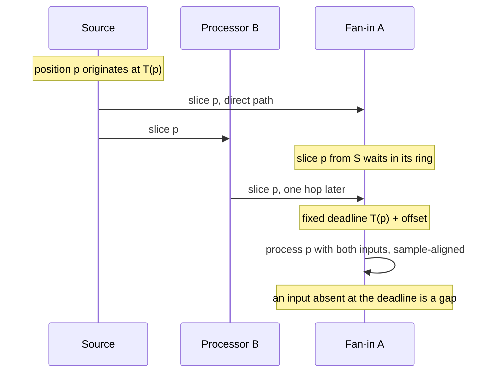
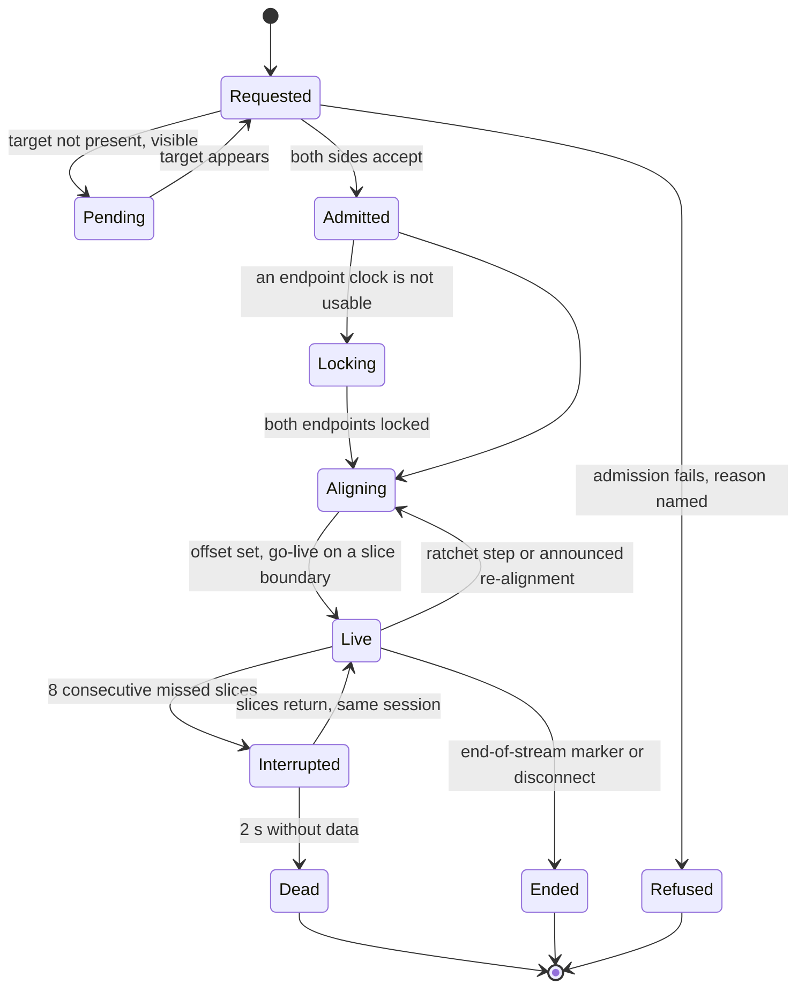
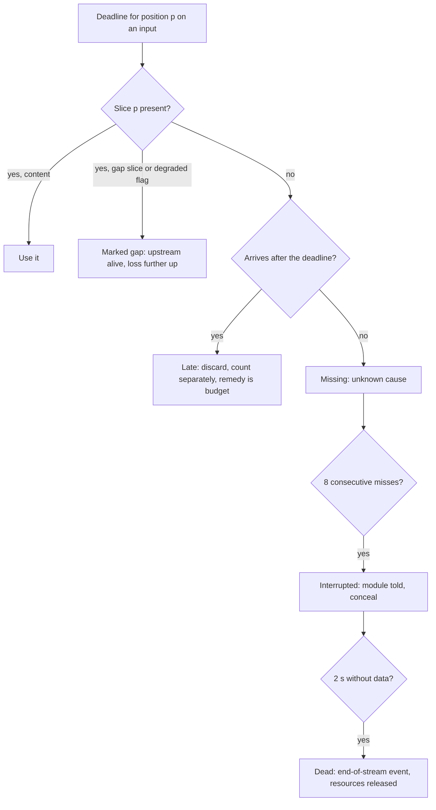
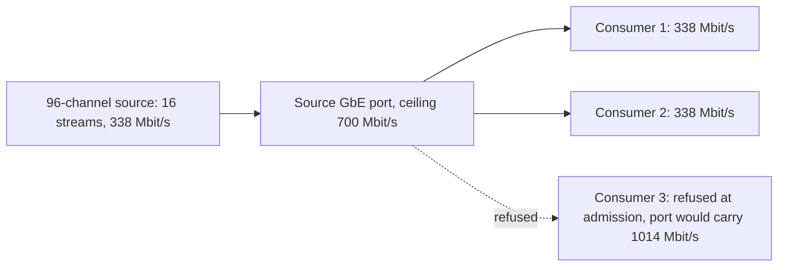
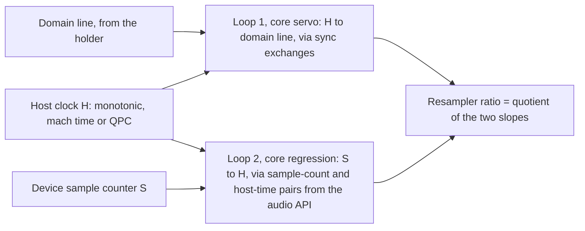
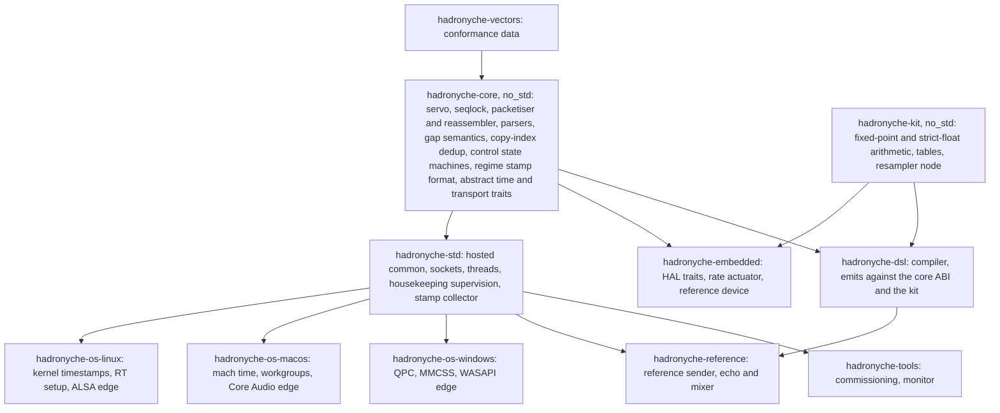

# 01 — Architecture specification

This document is the architectural specification of the Hadronyche Medianets runtime. It states what the runtime is, what it guarantees, and where the boundaries lie. Numbers are quoted from [02-constants.md](02-constants.md) with their ids (C-nn). Decisions are justified in the [ADRs](adr/). Evidence tags are defined in [00-context.md](00-context.md).

Contents:

1. [Scope and protocol stack](#1-scope-and-protocol-stack)
2. [Clocking](#2-clocking)
3. [Protocol and packetisation](#3-protocol-and-packetisation)
4. [Graph semantics](#4-graph-semantics)
5. [Control-plane invariants](#5-control-plane-invariants)
6. [Capacity and admission](#6-capacity-and-admission)
7. [Channel bundles](#7-channel-bundles)
8. [Capacity map](#8-capacity-map)
9. [Edge contract and presentation](#9-edge-contract-and-presentation)
10. [Platform compatibility](#10-platform-compatibility)
11. [Numbers governance](#11-numbers-governance)
12. [DSL contract](#12-dsl-contract)
13. [Crate split](#13-crate-split)
14. [Boundary table](#14-boundary-table)
15. [Failure semantics](#15-failure-semantics)
16. [Verification tiers](#16-verification-tiers)
17. [Acceptance criteria per section](#17-acceptance-criteria-per-section)
18. [Rules settled after the ticket split](#18-rules-settled-after-the-ticket-split)

---

## 1. Scope and protocol stack

A **medianet** is a wired, isolated LAN whose only traffic is the runtime's. **Modules** (sources, processors, sinks) discover each other, agree on one clock holder, and exchange **slices**: all content for one stretch of media time, addressed by **position** on a domain-wide timeline.

The runtime owns *when and whether* content moves. Module code owns *what* the content is. The operator owns *how much* latency and capacity to spend. Section 14 gives the full boundary.

### 1.1 Deployment view

- Backbone roles (clock holder, election candidacy, conformance, commissioning) are Linux only.
- macOS and Windows machines join as edges: sinks and physical-input capture.
- Embedded devices are followers and narrow sinks or sources.
- A medianet needs at least one holder-capable node, or there is no audio.

### 1.2 Protocol stack

| Layer | Carries | Transport | DSCP (C-13) |
|---|---|---|---|
| Discovery and control | hello, election, admission handshake | UDP multicast (hop limit 1) and unicast | CS5 (40) |
| Clock sync | request / reply exchanges with the holder | UDP unicast | CS6 (48) |
| Media | slices: audio, dense controllers, sparse keyed controllers, transport state, in-band announcements | UDP unicast, one packet per slice by default | EF (46) |
| Measurement | receiver reports, one-way probes | UDP unicast, reverse port from the handshake | reports CS5 (40); probes EF (46) |

### 1.3 Per-module runtime

- One housekeeping thread and one clock thread **per process**; one data thread per module. The POC's three threads per module are retired.
- The data thread never takes a lock shared with housekeeping (invariant L-8, section 5).
- A panic in a data or clock thread terminates the process. A panic in housekeeping restarts housekeeping (invariant L-7).

---

## 2. Clocking

### 2.1 The domain line

There is **one timeline for the whole domain**. Every stream on a medianet is at the domain sample rate (C-01); an edge whose hardware runs at another rate converts at the edge. Position is network time counted in samples from a domain epoch:

`position = (network_time − epoch_origin) × rate`

- Streams do not have private origins. Two independent sources at the same rate share the same position space, so a mixer has a single timeline to stamp its output on.
- A capture edge stamps each sample with the position of its acoustic instant.
- The map is **affine per timeline epoch and never extrapolated across epochs**.

### 2.2 Timeline epochs

A **timeline epoch** is a 16-bit counter (C-10), distinct from the election epoch. A continuous clock handover does not change it; a discontinuity does.

- The epoch is carried in every sync reply and in every slice header.
- When a module's clock thread learns a new epoch from sync, each of its sources announces in-band the future position at which it switches (lead C-43), and restarts its session there.
- A fan-in treats an input that is still on another epoch as a gap.
- A holder that detects its own stall (for example the host was suspended) bumps the epoch.
- If no module with usable time (C-213) is available to take the clock, the new holder bumps the epoch.

### 2.3 Holder and election

- The holder's monotonic clock defines network time. Followers estimate their offset with request/reply exchanges (C-36) on the sync port.
- **Holder loss is judged on sync replies only** (C-37). A hello that expires while replies still flow never opens an election (invariant L-6).
- The holder changes only on loss or pressure. Rotation is retired.
- **Eligibility is a capability bit in the hello.** A candidate must have usable time (locked, or in holdover with its claim not lapsed, C-213), be on a host not under I/O pressure, and be able to serve up to 64 followers (C-35). Embedded and macOS/Windows nodes do not set the bit in v1.
- Every module computes the same winner from the same candidate set; higher election epoch wins on merge.
- **Handover is frequency-continuous.** The new holder starts at the old holder's rate and relaxes to its own crystal within C-61.

### 2.4 Servo requirements

The follower servo is a redesign of the POC servo. It keeps the estimator idea (per window, use the exchange with the smallest round trip, C-66) and changes the actuation.

| Requirement | Statement |
|---|---|
| Continuity | Published time is continuous while locked: zero phase step across updates. Corrections act on frequency only |
| Slew | At most 10 ppm from the holder's rate (C-60) and 1 ppm/s change of rate (C-61) while locked. Acquisition is exempt |
| Lock is a number | The published view carries an error bound. Locked requires bound ≤ C-62 |
| Acquisition | Locked is reached within C-63 of the first exchange (a proposal the simulation confirms or replaces) |
| Honest lock | The servo never reports Locked while true error exceeds its published bound |
| Pacing | Requests are paced by deadline; the achieved rate equals the configured rate and is reported |
| Wall clock | A wall-clock step between kernel stamp and read is detected and the sample discarded |
| Holdover | In holdover the bound grows by C-64; alignment claims lapse when the bound exceeds a consumer's margin (C-65) |
| Steps | A step larger than C-67 is never slewed; it is a timeline epoch change |
| Asymmetry | One-way figures carry the worst-case asymmetry bound; no in-band method can observe asymmetry |

Why this matters: sources pace position from network time, so servo behaviour reaches hardware edges as resampler ratio. Inside the network, alignment is by position and servo wobble only consumes deadline margin.

`[code]` The POC servo steps the phase estimate at every update, paces by a receive timeout (at `poc-untouched`; `poc-baseline` waits for the next request deadline instead, task 003, BASELINE.md section 2), and has a holdover that never expires. All three are retired.

### 2.5 Publication

The servo publishes its view (offset at a reference time, drift, state, error bound, timeline epoch) through a seqlock. Invariant: the writer must never be preempted mid-write by a higher-priority reader on the same core.

### 2.6 Multiple processes on one host

Each process runs its own servo against the holder. Two processes on the same host can disagree by up to twice the clock bound. There is no shared-memory clock in v1.

---

## 3. Protocol and packetisation

### 3.1 Slices and packets

- A **slice** is the content of one stream for one stretch of positions (C-02). The handler receives a slice whole or not at all.
- **By default a slice is one packet** (C-05). At defaults a stream carries 6 channels (C-04).
- IP fragmentation is forbidden: every packet is sent with don't-fragment set.
- A slice larger than the path MTU is an explicit **multi-packet regime**: the runtime splits it into ordered packets, each stamped, and reassembles it. The regime is recorded in the stamp.

`[code]` The POC sends one 9.6 KB datagram per slice, which is 7 IP fragments at MTU 1500 (P-01). That is retired.

### 3.2 Wire layout

Rules the layout must satisfy (exact field offsets are spec drafting, task 004):

- Streams are identified by **source and stream number**, never by destination. The receiver demultiplexes on the source address pinned at admission plus the stream number.
- **Forward packets carry no per-receiver state.** Round-trip closure uses the measurement path (3.6).
- The 64-bit module id is not in media packets; it lives in the control plane.
- The **session number is assigned by the source**, one per stream, and bumped on restart and on timeline epoch change (C-19). Every consumer of a stream sees the same value.
- The **copy index** (C-07) is reserved for duplication. Dedup rule: by stream, position and packet index; the first valid copy wins.
- A **gap slice** is header-only and marks positions the sender knows it did not produce or receive. The **degraded flag** marks a slice computed from a gapped input.
- Timing measurements are in the optional extension, not in the stream header. Production streams may omit it.
- A version mismatch is a named event, not a silent drop.

### 3.3 Path MTU

- At admission the two ends run a **probe pair**: a padded don't-fragment packet at the intended size, and an acknowledgement. Silence means the path is smaller.
- On failure, fall back to C-06.
- Re-probe when large packets vanish while liveness holds.
- The path MTU of each connection is in the regime stamp.

### 3.4 Egress pacing

- Packets of one slice period are spread over at most 25 % of the period (C-14).
- Each source adds a phase offset derived from its id. Without it, every source sharing the timebase fires on the same slice boundary and bursts arrive coherently at a switch port.
- Pacing runs in userspace on the deadline clock, so per-packet send timestamps stay true.
- Per-output override: 0 disables spreading.

### 3.5 DSCP

Three classes (C-13). Sync rides its own class above media because the servo wants the least and most symmetric delay; the media path is measured separately by slice stamps. Marking is **verified by the receiving peer**, which reads the received byte and reports it in the receiver report. No platform is trusted to self-report.

### 3.6 Measurement path

The admission handshake carries a reverse unicast port. The v1 message set is exactly:

| Message | Sender | Rate | Content |
|---|---|---|---|
| Receiver report | consumer's data thread | one per bundle per 100 ms (C-40) | per-member received, late, lost, interrupted counts; socket and interface drop counters; observed DSCP |
| One-way probe request / reply | either end | on demand | timestamps closing a round trip |

Receiver reports are also the producer's only evidence that its consumer is alive (C-41).

### 3.7 Redundancy

v1 is **detect, classify, conceal, account**. Retransmission and forward error correction are rejected (ADR 04). Duplication over a second path, or delayed on the same path, is deferred; the copy index reserves it.

---

## 4. Graph semantics

### 4.1 Position invariant

A module's output for position p is derived from its inputs at position p. The runtime stamps output positions; module code cannot change them. A module with declared structural delay L has its output stamped p − L while it processes input p. Stamps denote **content position** and are never restamped per hop.

### 4.2 Fan-in alignment

- **Align only where needed.** Single-input modules are arrival-driven and forward immediately. Deadlines exist only at fan-in points and at sinks.
- A fan-in consumer holds each aligned input in a ring indexed by position. Rings are sized to the presentation group's A, which caps the skew budget (C-96).
- It processes position p at the fixed time `T(p) + offset`, with whatever has arrived. Anything absent is a gap.
- **It always fires at the fixed time**, never early when all inputs happen to be present. Early firing would make output timing data-dependent.
- Alignment is sample-exact by position, whatever the clock error. The clock only decides when the deadline fires.
- A return edge in a cycle is declared unaligned. A per-input "unaligned" opt-out exists (mix on arrival).

### 4.3 Offset: estimation and ratchet

- During the **aligning** state (C-50) the consumer measures origin-to-arrival lateness per input. This already includes every upstream hop, so nobody needs to know the critical path.
- Offset = maximum observed lateness plus headroom (C-51, C-52).
- The offset is frozen once live. It is a **ratchet**: it grows automatically by C-53 when an input is persistently late, after dwell C-54; it never shrinks automatically; its ceiling is the presentation group's A (section 9).
- Beyond the ceiling the offending input is demoted to gapped. This guarantees termination when one edge flaps.
- A path that became shorter leaves the offset safe; the runtime reports reclaimable latency and does nothing.

### 4.4 Connection states

- A locking member is **present but not live**: its inputs to others are declared silent, not gaps, not loss.
- Go-live is the consumer's local decision, on a slice boundary, flagged on the first slice.
- Resuming from Interrupted is immediate at the frozen offset.

### 4.5 In-band announcements

Anything with a position deadline travels in slices, not in gossip: end-of-stream, re-alignment, timeline epoch switch, transport reference change.

- An announcement names a future position, with lead C-43, and is re-issued per C-44.
- Consumers process positions in order, so an announcement is always processed before the position it names. The lead exists only to survive loss.
- A re-alignment announcement placed in the triggering consumer's output reaches exactly its descendants, which are exactly the affected set. A fan-in that receives two takes the later position.

### 4.6 Gap contract

Timing is always the consumer's deadline. Markers exist for classification.

- A consumer that processed a gap marks its own output slice degraded.
- If a module misses its own deadline, the runtime emits the gap slice for it.
- **Default concealment** (runtime default per content type, per-connection override): audio zero-fill; dense controllers hold last value; sparse keyed controllers rely on state refresh.
- Click-free behaviour is guaranteed only for announced transitions. A fade-out after an unannounced loss is impossible without lookahead.

### 4.7 Lineage

The measurement extension carries hop count, accumulated residence time and accumulated declared delay. At a fan-in the critical input's values propagate. Residence is self-accounting (it appears in downstream lateness); it raises one event, "processing overrun", when a module completes after its deadline. Positional delay cannot be observed live; it is verified by the latency probe tool (section 16).

---

## 5. Control-plane invariants

Housekeeping is not real-time and can be starved. These invariants ensure a healthy live stream cannot be damaged by it.

| ID | Invariant |
|---|---|
| L-1 | An admitted, healthy connection becomes dead only from data-plane evidence: Interrupted after C-38, Dead after C-39. Gossip silence alone never tears down a live stream. **Reverse direction:** the producer stops only after C-41 without receiver reports |
| L-2 | All position-deadline control travels in-band in slices (4.5). Guaranteed delivery is not required because re-issue is free and the event names a position |
| L-3 | Gossip is discovery, admission bootstrap and election input only. A follower that receives no sync replies for C-37 opens an election regardless of hellos |
| L-4 | Housekeeping admits unknown sources only. It never touches a live data path. Its remaining failure is that new modules join slowly under starvation, which is a diagnostic |
| L-5 | Destinations are pinned at admission and change only by re-admission. A hello with a new address never redirects a live stream |
| L-6 | The holder is judged by sync replies only. Hello expiry never opens an election while replies flow |
| L-7 | Fail-stop applies to data and clock threads. Housekeeping is supervised and restarted; the module is marked control-degraded |
| L-8 | No lock is shared between housekeeping and the data or clock threads |

Transport reference changes are recognised in-band, not from gossip.

`[code]` The POC violates L-1 (expiry tears down routes), L-5 (routes rebuilt on address change), L-6 (`leave()` opens an election when the holder's hello expires) and L-8 (the clock thread locks a mutex shared with housekeeping every iteration).

---

## 6. Capacity and admission

### 6.1 Handshake

Connection is **two-sided**. The requester names a source output (or bundle members) and a consumer input; both sides accept or refuse.

- Refusal is explicit and terminal, with a named reason. "Target not present" stays Pending and visible, with no timeout: until the target appears or the operator cancels (C-45).
- Refusal reasons (closed set of 18, C-173 and C-185): PortCeiling, PacketRate, SliceRate, InputCount, BufferMemory, CostBound, ContentMismatch, NotAnInput, VersionMismatch, ForeignDomain, PathMtuTooSmall, RequiredEExceeded, FollowerCap, ModuleCap, NameTaken, BadMemberList, ControlDegraded, NoSkewBudget.
- The handshake carries: declared rates, the bundle member list, the path-MTU probe pair, the reverse measurement port, the pinned addresses, the manifest (ports, content types, required E for presentation groups).
- An operator alarm is raised through the hello's alarm field.
- The graph is a desired set; the runtime publishes satisfied versus unsatisfied. There are no all-or-nothing groups in v1.

### 6.2 Units

| Unit | Checked by |
|---|---|
| bit/s on the wire, including headers | sender against its interface; receiver against its interface |
| packets/s | receiver |
| slice rate | receiver |
| input count | receiver |
| buffer memory (skew budget × rate) | receiver; decisive on embedded |
| compiler cost bound per slice | receiver, for DSL modules |

CPU for non-DSL modules is a diagnostic (overrun counter and alarm), not admission.

### 6.3 Ceilings

- Each endpoint link is admitted up to 70 % of its rate (C-23).
- **Endpoint admission is online and dynamic.** On a single switch every link is an endpoint link, so endpoint sums are complete.
- **Trunk links are never computed by the runtime.** Their capacities are declared in the commissioning configuration; the commissioning tool validates the requested graph offline and alarms post hoc through the stamp.
- At most 64 active modules per medianet (C-34) and 64 followers per holder (C-35).

### 6.4 Enforcement at the receiver

The bounded-time promise on the data thread is made real by three mechanisms, not by a token bucket:

- a **bounded drain** per input per cycle (C-16);
- a **source filter**: only admitted peers are parsed;
- a **socket buffer sized to the declared rate times the skew budget**, with the kernel's per-socket overflow counter read on every receive `[kernel-doc]`.

`[code]` The POC drains every input socket completely before looking at its own deadline, so one flooding input starves the ticker.

---

## 7. Channel bundles

Streams stay narrow; a wide source emits a **bundle** of aligned streams.

- A bundle is a group id, a member list and a channel map, declared in the manifest. At defaults each member carries 6 channels (C-04); a 96-channel source is 16 members.
- **Members are independent on the wire**: per-member gaps, per-member interrupted/dead. The bundle is dead when all members are.
- **One offset is not optional**: every aligned input of a consumer shares that consumer's firing time.
- **One admission handshake** lists the members wanted. A narrow sink subscribes to only the members it needs.
- **One socket per bundle** at the consumer, demultiplexed by stream number. Batch receive is required.
- **One receiver report per bundle** (C-40) with per-member counters.
- Announcements are re-issued in every member (C-44).
- Controllers ride in their own member.

Cost, stated plainly: "all content for a time stretch arrives together or not at all" now holds **per member**, not per source. A lost controller slice means hold-last-value while audio plays.

Bounds: 32 members per bundle (C-08), 256 streams per source (C-09).

---

## 8. Capacity map

### 8.1 Rates

| Source width | Streams | Wire rate | Packets/s | Fit one GbE port at 70 % |
|---|---|---|---|---|
| 24 channels | 4 | 84 Mbit/s | 8 000 | 8 |
| 48 channels | 8 | 169 Mbit/s | 16 000 | 4 |
| 96 channels | 16 | 338 Mbit/s | 32 000 | 2 |

The limit is per endpoint port, not per medianet. Any number of 96-channel groups coexist on a non-blocking switch as long as no port carries more than about 198 channel-copies (C-24).

### 8.2 The walls

| Wall | Where | Number | Status |
|---|---|---|---|
| 1 | GbE endpoint port | about 198 channel-copies: a 96-channel source feeds two consumers by unicast, not three; a mixer takes two 96-channel sources, not three | derived |
| 2 | Receive cost per slice at the consumer | two bundles are 32 packets per 0.5 ms; guessed 2 to 4 µs each (C-93) | pending-measurement |
| 3 | Device port | a 100 Mbit port holds about 19 channels (C-26) | derived |

Not walls: memory (C-27) and clock serving (per process, independent of streams).

**Decision:** any port beyond wall 1 runs 10 GbE (C-25). Multicast fan-out stays deferred.

---

## 9. Edge contract and presentation

### 9.1 One formula

For a sink in a presentation group with audition offset A:

- **Emission:** `emit(p) = T(p) + A`
- **Hand-off to hardware:** `submit(p) = emit(p) − D`

where T is the domain line, and D is the sink's declared total plumbing delay (driver buffer, resampler, converter). Capture is the mirror: a sample is stamped with the position of its acoustic instant, `T⁻¹(capture_time − D_capture)`. With both, A is exactly the mouth-to-ear latency.

### 9.2 Presentation groups

- A is **operator configuration**, one per presentation group; the default group is the whole domain (C-55).
- The commissioning tool proposes the minimum feasible A (largest over sinks of lateness + D + margin). The runtime verifies continuously; a sink that cannot meet A alarms.
- A is the ceiling of every fan-in ratchet upstream of the group.
- A group carries a **required E**. It is enforced in the admission manifest exchange: a sink whose E exceeds the group's required E is refused with a named reason. The commissioning tool certifies membership.

### 9.3 E and D honesty

- **E** is the 99.9th percentile of |actual emission − (T(p) + A)| over a one-hour certification run, with the maximum reported beside it (C-73). On hosted platforms E is a percentile claim, not a bound. Only embedded can claim a bound.
- E decomposes into clock bound + rate-tracking error + uncertainty of D.
- A sink self-monitors the first two continuously. The analogue part of D needs an external commissioning measurement. Certification is therefore two-tier.
- **D must be repeatable across restarts** (C-74).
- A sink that cannot bound E cannot claim presentation alignment. Certification failures are in the stamp.
- Edge modules resample and are never exact-tier.

### 9.4 Two-loop timebase

- Both loops are shared core code. A platform supplies two traits: a host clock and a device clock, each with a declared jitter.
- The published quality number is clock bound plus regression residual.
- The rate loop is a second servo cascaded on the first, with bandwidth well below 1 Hz (C-68), so it filters servo jitter.
- **v1 steers a software resampler on every profile.** The embedded HAL defines a rate-actuator trait with that one implementation; hardware clock trimming later needs nothing on the wire.

### 9.5 Certification ladder

| Rung | Setup | Pass criteria |
|---|---|---|
| L0 | Loopback, one process, injected offset and drift | Exact tier: zero content mismatches; zero loss; lock reached; estimated minus true offset within the published bound; every check family has non-zero samples. Assertions never depend on sync-rate timing |
| L1 | Two machines, one wire | Asymmetry bound holds; loss at or below the floor (C-90); in the multi-packet regime, first-packet and slice-complete latency differ by the serialisation time; zero late slices at the commissioned A; C-92 |
| L2 | One machine plus a reference sink per platform; the sink follows an in-process module with injected drift and steps; capture read raw against the hardware counter | E within target (C-70, C-71, C-72); restart spread within C-74; C-75; C-76 after injected loss, a handover per C-78 and an announced step; C-77 |
| L3 | A hosted sink and an embedded sink play the same stream into two channels of one capture device | C-79 |

Two traps the L2 design avoids: a lone host is its own holder, so the servo is idle unless drift is injected; and a loopback through one sound card shares one crystal, so two resamplers would cancel each other's error.

---

## 10. Platform compatibility

### 10.1 Capability table

Platform facts for macOS and Windows are `[memory]` until task 001 (stamp probes) and the L2 runs confirm them.

| | linux-std | macos-std | windows-std | embedded |
|---|---|---|---|---|
| Receive timestamp | Kernel, wall-clock basis `[kernel-doc]` | Kernel, monotonic basis (to verify) | Kernel on recent builds (to verify), else userspace | MAC hardware, else interrupt |
| Real-time threads | `SCHED_FIFO`, needs privilege | Time-constraint policy plus workgroup, unprivileged | MMCSS Pro Audio, not hard real-time | By construction |
| Audio stack | ALSA | Core Audio device callback | WASAPI exclusive | HAL |
| D obtained from | Driver delay plus measurement | Device latency properties plus measurement | Measurement only | Design plus measurement |
| E dominated by | Clock bound | Device class | D uncertainty, scheduling spikes | Timestamp source |
| E target | 50 µs (C-70) | 100 µs (C-71) | 1 ms (C-72) | Declared per device |
| Report-only on this platform | — | Overflow accounting | Overflow accounting, DSCP marking, bounded real-time, sub-millisecond pacing | Housekeeping isolation, supervised housekeeping, optional injection and counters |
| Roles | All | Edge only | Edge only | Edge, follower |

For every hosted platform: interrupt coalescing on the NIC biases software receive stamps; commissioning disables it on medianet interfaces.

### 10.2 Scope on macOS and Windows

- **Capture is physical device inputs only.** Application-output capture (a virtual audio device) is out of v1.
- **Windows:** WASAPI exclusive mode is mandatory for certification. Sink edges do not pace. Capture edges pace emission off the audio callback, batching several slices per engine period; this is stamped. There is no spinning ticker.
- **macOS:** direct devices only; aggregate devices are excluded.
- If the musician's own software holds the interface, the edge reports it and certifies nothing.
- The media deadline clock exists in core only as an abstract trait; each backend provides it.
- Laptop devices often run at 48 kHz. The edge resampler absorbs the 2:1 ratio; it adds to D.

### 10.3 Porting traps

**macOS.** A laptop has Wi-Fi up beside the medianet port, and multicast follows the default route unless every socket is pinned to the medianet interface. Recent releases gate local-network access behind a per-app permission prompt. The machine sleeps on lid close, so a live edge holds a power assertion. Background throttling applies unless the process is marked as audio work. There is no per-socket drop counter. Don't-fragment is a different socket option from Linux's.

**Windows.** Default timer granularity is 15.6 ms and the best waitable timer is about 0.5 ms. A UDP socket that sent to a dead peer starts failing its receives with a connection-reset error unless that behaviour is switched off. The firewall blocks inbound UDP until a first-run prompt is accepted. Setting an arbitrary DSCP value goes through the QoS API and may need administrator rights or policy. There is no per-socket drop counter. The default receive buffer is 64 KB. Third-party driver interrupt work produces millisecond scheduling spikes that user space cannot bound.

### 10.4 Uncertifiable in v1

- Any bound on Windows scheduling latency.
- Any device whose driver misreports latency, without a commissioning measurement.
- macOS aggregate devices; Bluetooth and network audio outputs.
- Every OS, driver and device combination outside a short reference list (stamped "unverified").
- Isolation of a laptop: it is dual-homed and emits discovery chatter on the medianet port.

### 10.5 Trust statement

"Trusted segment per the recommended configuration; Windows and macOS edges are best-effort members of a weaker segment." The commissioning baseline is a dedicated medianet NIC with OS discovery chatter suppressed (per-OS checklist) and the firewall scoped to medianet ports. Control authentication using the reserved fields (C-12) is scheduled immediately after v1.

---

## 11. Numbers governance

The POC's first measured run produced a corrupt metrics file, a garbage loss counter and two inert check families on a run that looked green ([06-evidence-appendix.md](06-evidence-appendix.md)). The following are therefore first-class surface.

### 11.1 Regime stamp

The stamp is a **wire object defined in core**, because a device cannot write files: it publishes its stamp and a hosted collector records it. It travels in a dedicated control message, sent on request and on any regime change, split into sections that each fit the control message bound; the hello carries only a stamp version number (C-18).

| Group | Fields |
|---|---|
| Identity | protocol version, build identity, full configuration, domain, profile (linux-std, macos-std, windows-std, embedded) |
| Capability bits (present / absent / unverified / not requested) | receive timestamp source, real-time scheduling granted, memory locked, drop accounting, DSCP marking, fault injection, holder-eligible, control isolation (housekeeping cannot delay the data path) |
| Network | interface, interface MTU, path MTU per connection, packets per slice, pacing mode, DSCP classes and peer-observed values, coalescing state |
| Clock | discipline mode, lock state and bound at each one-way figure, timeline epoch |
| Alignment | offset, the lateness percentiles, A, required E |
| Platform | OS build, audio device, driver |
| Drops | per-socket overflow, interface drop counters, measurement-buffer overflow |
| Connections | per-connection summary counters (received, late, lost, interrupted), published by both producer and consumer so that a monitor or commissioning tool can observe stream health without seeing receiver reports (C-47) |
| Injection | any active injection, always stamped |

Rules:

- A change of regime mid-run starts a new record set; it is never averaged across.
- A measurement involving two endpoints carries both profiles.
- One-way figures are blank until lock and carry the bound thereafter.
- **A check family with zero samples is a failed run.**
- **A file has one writer, owned by the process**, never by a module.
- Loss is reported at both levels in the multi-packet regime: packet loss (the link) and slice loss (the application).

### 11.2 Injection as public API

Clock offset and drift; packet loss, delay and reordering from a seeded generator; per-hop delay. Injection lets multi-packet and fan-in behaviour be tested on loopback without privileges. It may be absent on embedded (stamped).

### 11.3 Self-test

Before any number is reported: receive timestamps present and consistent with the monotonic clock; real-time scheduling actually granted; measured wake latency; packets per slice; clock locked within its bound. Numbers produced before the self-test passes are labelled unqualified. **Strict mode** turns a failed check, or domain 0, into a refusal to start.

### 11.4 Loss floor

The expected loss floor (C-90) is published. Measured loss above the threshold (C-91) raises an alarm: loss rate becomes a cable-health diagnostic.

---

## 12. DSL contract

The module-construction DSL is part of the product. The compiler owes the runtime the following.

### 12.1 Process function

One `no_std` pure-Rust function per module:

`process(state, inputs at position p with per-input gap flags, position) -> outputs`

- Never blocks. **No allocation at process time.** The compiler emits the state size and worst-case stack as constants.
- No libm and no transcendental functions. The arithmetic kit is strict f32 operations, Q1.31 and Q0.32 fixed point, and shipped deterministic tables.
- Float operations are never reordered; summation order is defined by DSL semantics.

### 12.2 Manifest

Ports, content types, rates, slice sizes, bundle layout, admission figures, ABI version, state size, stack bound, cost bound, structural latency, determinism class, and generated conformance vectors for exact-class programs.

### 12.3 Cost bound

With no unbounded loops, the compiler derives an operation-count bound per slice. Admission uses it (section 6.2).

### 12.4 Structural latency

L is a compile-time constant covering explicit delays, lookahead, block buffering and linear-phase filter centres, **in source-rate samples**. Recursive filters have frequency-dependent delay; the compiler reports that as a property, not a number. Port rates are manifest-declared. Cross-rate composition goes only through the kit's rational-ratio resampler node, whose delay the compiler knows exactly.

### 12.5 Determinism classes

| Class | Scope | Verification tier |
|---|---|---|
| exact-fixed | Everywhere, including between host and device | Exact, record and replay |
| exact-float | Only where the startup fingerprint matches | Exact, record and replay |
| bounded | Everything else | Tolerance |

**Fingerprint:** a compile-time vector (including subnormal and NaN paths) is evaluated at start **on the processing thread itself**, because floating-point modes are per thread and audio stacks change them. Match means exact-float eligible; mismatch means the module runs bounded-class and the stamp says so. The listed-target set is whatever CI verified.

### 12.6 Gaps and degraded marking

Compiler-generated defaults per content type (section 4.6), overridable by DSL constructs. **Degraded marking is derived per output from dataflow.**

### 12.7 Content domains, v1

Audio; dense controllers; sparse keyed controllers (one field of one voice moving linearly to a value over the slice, repaired by state refresh); read-only transport state as an input. **Transport authoring is deferred past v1.** The reference echo is a DSL program.

---

## 13. Crate split

- **Control logic lives in core**, not only packet definitions: discovery map, election, admission handshake and connection states are pure state machines (message and time in, messages and events out). Both profiles then run one implementation, and a device implements only a transport trait.
- Consequences: fixed-capacity peer map (C-34), control message size bound (C-17), **binary control format**.
- Hosted builds have an edge-only feature: no holder candidacy.
- Rewrite, not evolve: the POC is frozen as reference instrument; specific pieces are ported (ADR 21).
- The POC is frozen after the tag `poc-baseline`: nothing is written into it except by task 003, which ended with that tag (C-130) `[decision]`.

---

## 14. Boundary table

| Runtime contracts: when and whether | Module-author policy: what | Operator policy: how much |
|---|---|---|
| Position stamping and the position invariant | Mixing law and processing | A per presentation group |
| Alignment, fixed-time firing, deadlines | Concealment beyond the defaults | Required E per group |
| The four gap classes and degraded marking | Fades on announced transitions | Ratchet ceiling (through A) |
| Admission, connection states, pinned destinations | Declared structural latency (non-DSL modules) | Strict mode |
| Pacing, counters, the stamp | Resampling for hardware-clocked edges (through the kit) | Per-input alignment opt-out |
| Gap slice emitted when a module misses its deadline | Determinism class claimed (non-DSL modules) | Pacing override, trunk capacities, domain id |

---

## 15. Failure semantics

Each line is a reliance-grade statement with its machinery. "Diagnostic" means report-only.

| Situation | Statement | Detects | Acts | Action | Grade |
|---|---|---|---|---|---|
| Data or clock thread panics | The process exits; no module stays alive but silent | The process | The process | Exit | Guarantee |
| Housekeeping panics | Live streams continue | Supervisor | Supervisor | Restart; mark control-degraded | Guarantee (hosted); unsatisfiable on embedded |
| Data plane stalled | Visible within C-42; consumers conceal at their deadline | Own housekeeping; consumers | Self; consumers | Self-report and alarm; conceal | Guarantee |
| Peer absent | Interrupted after C-38, dead after C-39; producer stops after C-41 | Consumer and producer data threads | Same | Conceal; end-of-stream; stop sending | Guarantee |
| Holder lost | Election after C-37 of reply silence | Follower clock threads | Election state machine | Elect; frequency-continuous handover | Guarantee |
| Wrong content from a running module | — | Nobody | — | — | None |
| Partition heals | One holder within C-33 + C-30; every module computes the same winner | Housekeeping | Same | Adopt | Guarantee |
| Timebase discontinuity | Never slewed silently; new timeline epoch; sessions restart at an announced position | Clock thread | Sources, in-band | Announce, restart session; fan-in treats other-epoch input as gap | Guarantee |
| Continuity across a merge | — | — | — | — | None |
| Foreign domain traffic | Never affects this domain | Parser | Parser | Drop and count | Guarantee |
| Hostile control on the segment | — | Housekeeping, for unknown ids | — | Log | Diagnostic; authentication after v1 |
| Id collision | Detected within one hello period; never silent | The pair, and third parties seeing two nonces | Later joiner; third parties | Redraw and rejoin; quarantine the id until one nonce has been seen alone for 3 s (C-46) | Guarantee |
| Malformed traffic | Never crashes, never changes state, bounded time | Parser | Parser | Drop and count per input and reason | Guarantee; rate alarm is a diagnostic |
| Version mismatch | Named event; connection refused with reason | Housekeeping (version is in the hello) | Admission | Refuse | Guarantee |
| Sink exceeds group E | Refused membership | Admission | Admission | Refuse with reason | Guarantee |
| Trunk oversubscribed | — | Commissioning tool, offline | Operator | Alarm via the stamp | Diagnostic |

Ids: 64-bit from the OS random source plus a 64-bit instance nonce (C-11). Devices without a true random source mix a hardware unique identifier with a persistent boot counter.

---

## 16. Verification tiers

The POC's bit-exact claim is a property of its test instrument. The runtime replaces it with separately stated guarantees.

| Tier | What it proves | Mechanism |
|---|---|---|
| Transport integrity | Bytes delivered equal bytes sent, per slice | Slice checksum |
| Protocol conformance | Any implementation speaks the protocol | Byte-level vectors both directions including malformed inputs; state-machine scenario vectors; fuzzing |
| Reference modules | Kept permanently | Reference sender, echo and mixer; bit-exact by construction |
| Exact tier | exact-class modules, including user DSL modules | Record input slices and output hashes; replay the same code offline; compare |
| Tolerance tier | bounded-class modules | The POC analyzer windows and per-voice projections, with stated epsilons |

- **Gap semantics for the exact tier** inherit the POC baseline: windows touched by loss or by a degraded slice are excluded and counted; the reference instrument must resynchronise within a stated bound.
- **Reference mixer on a gap:** a missing input contributes zero and the output slice is marked degraded.
- The received-positions bitmap (which would let the sender replica apply the same gaps) is deferred.
- A **latency probe tool** sends a marker through a module in test mode and locates it in the output; this is how declared or compiler-derived L is verified.
- User module correctness outside these tiers is not a runtime guarantee.

---

## 17. Acceptance criteria per section

The enumerated criteria are in [03-acceptance-criteria.md](03-acceptance-criteria.md).

| Section | Criteria |
|---|---|
| 2 Clocking | AC-2, AC-3, AC-4, AC-5, AC-6, AC-7, AC-25, AC-36 |
| 3 Protocol and packetisation | AC-1, AC-19, AC-23, AC-34 |
| 4 Graph semantics | AC-10, AC-14, AC-15, AC-16, AC-17, AC-18 |
| 5 Control-plane invariants | AC-20, AC-21 |
| 6 Capacity and admission | AC-11, AC-12, AC-37 |
| 7 and 8 Bundles and capacity map | AC-13 |
| 9 Edge contract | AC-26, AC-29, AC-30 |
| 10 Platform compatibility | AC-27, AC-28, AC-35 |
| 11 Numbers governance | AC-8, AC-9, AC-31, AC-37 |
| 12 DSL contract | AC-32, AC-33 |
| 13 Crate split | AC-1 (one implementation of the state machines meets the vectors on both profiles), AC-35 |
| 14 Boundary table | No criterion of its own; it is enforced through AC-10, AC-16 and AC-33 |
| 15 Failure semantics | AC-21, AC-22, AC-23, AC-36 |
| 16 Verification tiers | AC-1, AC-8, AC-24 |

---

## 18. Rules settled after the ticket split

Splitting the epics into tickets exposed holes in this specification. The rules that close them are listed with their values in [02-constants.md](02-constants.md#rules-settled-after-the-ticket-split) as C-100 to C-229. Where a rule refines a statement above, the rule wins.

| Area | Rules | What changes above |
|---|---|---|
| Wire | C-100, C-115, C-116, C-04 | IPv4 only; no per-channel id byte in packets; the auth counter is live; the MTU probe is exempt from the control message bound |
| Rates | C-01, C-80, C-105 | one rate on the wire; conversion only at edges; L is rational |
| Gap contract (section 4.6) | C-102, C-108, C-109, C-110, C-111 | which classes count as a miss; late is a reclassification of missing; the Demoted health state; reassembly deadline for aligned multi-packet inputs; when the dead clock starts |
| Ratchet (section 4.3) | C-101 | the definition of persistently late |
| Clock (section 2) | C-112, C-113, C-114, C-121 | accepted sync rate range; election with no locked candidate; how the follower cap is tested; where wall-clock step detection lives |
| Edge (section 9) | C-79, C-103, C-124 | skew is compared as a 99.9th percentile; uncertified sinks; laptop sleep |
| Numbers governance (section 11) | C-18, C-47, C-107, C-120 | stamps are multicast on change and every 10 s; per-connection counters match the gap classes; commissioning window; test-only injection hooks |
| DSL (section 12) | C-104, C-106, C-122, C-123 | path-join padding; cost in abstract operations with calibration; degraded flag follows content; where the bounded class arises |
| Verification | C-118, C-119 | loss soak statistic; drift-ramp scenario |
| Process | C-117, C-125, C-126 | trunk capacity per direction; definition-of-done applicability; scope labels |
| Strict mode and capabilities (section 11) | C-127, C-128, C-129 | what strict mode requires; unverified is refused; a fourth capability state, not requested |
| Locations | C-130 | where specifications, reports and results are written |
| Latency, revised | C-104, C-105, C-134 | L is always a whole number of samples; resampler nodes only inside edge modules; joins with frequency-dependent delay padded on the structural part and flagged |
| Gap contract, further | C-135, C-141, C-158, C-159 | other-epoch slices; transport state on a gap; dense controller initial value; the full counter list |
| Clock, further | C-136, C-162 | holder stall detection; state after the holdover claim lapses |
| Wire, further | C-137, C-152, C-155, C-173 | 100-byte header cap; peer verification of sync and control DSCP; pacing fits the slice period; admission details |
| Alignment, further | C-142, C-157, C-163, C-169, C-174 | ungrouped fan-in; reclaimable latency; last ratchet step; margin with unknown E; the cannot-meet-A alarm |
| Edge and certification | C-140, C-149, C-150, C-170, C-175 | numeric E needs commissioning; pass criteria use the target E; E budget splits; definition of D; a held interface |
| Operations | C-138, C-139, C-147, C-153, C-154, C-165, C-172 | OS versions; housekeeping restart policy; strict mode and measurements; commissioning window; graph view; operator policy; hardware and switch lists |
| Verification, further | C-145, C-146, C-148, C-151, C-164, C-166, C-167, C-176 | panic injection; privileged nightly tests; A for ladder runs; machine pair; bad-input bound; L1, L2 and L3 parameters; calibration procedure |
| Process, further | C-143, C-144, C-171 | splitting oversized epics; owner of four orphan duties; more locations |
| Last round | C-177 to C-196 | pin failure and seqlock safety; what a commissioning window disqualifies; the loss level that reopens redundancy; a commissioned sink with an unlocked clock; controllers of a single-stream source; the lateness window; even-tap filters; initial transport state; the 18 refusal reasons; a changed A; who publishes clock state; where sync is answered; the two kinds of resampler; device-side joins; completed test parameters; dependency hygiene |
| Closing round | C-197 to C-207 | the kit builds every resampler and moves to P4; the receiver report carries a changed A upstream; default tempo and a stopped playhead; an unverified pin; sync loss at L2; tolerance for a pair of sinks; excess sync requests; bundle controllers; tool presentation details; resampler delay is never in L |
| Final points | C-208 to C-212 | each fan-in picks its own re-alignment position; the controller member counts towards the bundle cap; the kit epic defines the rate-actuator trait; a changed A that exceeds buffer memory; the L2 handover is a holder loss |
| After the last sweep | C-213 to C-219 | a module in in-bound holdover may take over as holder, so a holder failure does not restart streams; a sink picks its own switch position; every ratchet step is announced; details of a clamped A; peer map holds 63; who implements compile-time rejections; wire cost of a controller stream |
| Closing defaults | C-220 to C-229 | what L3 asserts through a handover; tie-break among candidates with usable time; the clamp applies to sinks too; how the 50 ppm handover difference is made up; how a sink learns a commissioned A; a ratchet step in a sink and its ceiling; which node wins the rig handover; who encodes commissioning-window messages; the since-live maximum survives a re-alignment |
