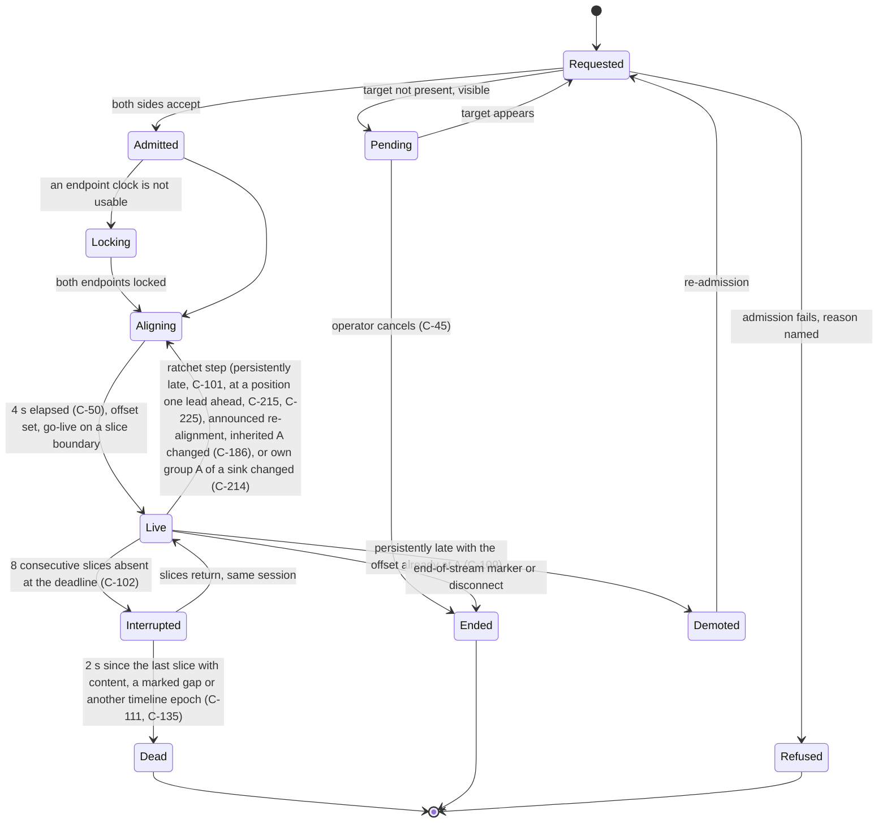

# 005 — Control state machines specification

**Phase:** P1 · **Scope:** L (27 tickets, about 33 days) · **Depends on:** 002, 004 · **Blocks:** 007, 011, 012, 006, 013, 014, 022a, 026a, 027

## Goal

Specify the four control state machines of the runtime as pure tables: discovery map, clock election, admission handshake and connection states. Each is defined as *(state, input message or timer) → (new state, output messages, events)*, with no I/O, so that one implementation in the `no_std` core serves both the hosted and the embedded profile and scenario vectors can be generated from the tables.

## Background

**Product frame.** Hadronyche Medianets are wired, isolated IPv4 LANs whose only traffic is this runtime's (C-100). Modules discover each other, agree on one clock holder and exchange *slices* addressed by *position* on a domain-wide timeline. Every stream on the wire is at the domain rate of 96 kHz (C-01); a slice is 48 frames, 0.5 ms (C-02). Linux hosts are the backbone (the only clock holders in v1); macOS and Windows machines are edges; embedded devices are followers. Control logic lives in `hadronyche-core` as pure state machines (message and time in, messages and events out); a device implements only a transport trait.

**Evidence tags.** `[code]` read in the POC · `[measured]` observed · `[decision]` design choice · `[standard]` a figure cited from a named, published standard with its clause (C-132). The constants table `doc/design/02-constants.md` is canonical; the ids below repeat its values and it wins on any difference.

### Constants `[decision]` unless marked

| Id | Constant | Value |
|---|---|---|
| C-01 | Domain sample rate | 96 000 Hz, the only rate on the wire; an edge at another rate converts at the edge |
| C-02 | Slice length (default) | 48 frames = 0.5 ms = 2 000 slices/s (inherited) |
| C-06 | Path-MTU fallback | 1 280 bytes |
| C-08 | Members per bundle | at most 32, the controller member included (C-209) |
| C-11 | Module id / nonce / domain | 64 / 64 / 16 bits; domain 0 = unconfigured |
| C-12 | Authentication reservation in control messages | scheme 8 bits (0 = none) + message counter 64 bits + tag 128 bits (reserved) |
| C-17 | Control message size bound | at most 1 252 bytes of UDP payload (one packet at the fallback MTU) |
| C-18 | Regime stamp transport | a dedicated control message in sections that each fit C-17; multicast to the control group on any regime change and refreshed every 10 s; a unicast request gives an immediate fetch; the hello carries only a stamp version number |
| C-19 | Session number ownership | assigned by the source, one per stream; bumped on restart and on timeline epoch change; every consumer of a stream sees the same value |
| C-22 | Wire rate per source | 96 ch: 16 streams, 338 Mbit/s, 32 000 packets/s (derived) |
| C-23 | Admission ceiling | 70 % of the link rate |
| C-30 | Hello period | 1 s (inherited from the POC) |
| C-31 | Hello expiry | 3 s, for non-live peers only (inherited) |
| C-32 | Listen-before-claim | 1.5 s (inherited) |
| C-33 | Election window | 400 ms (inherited) |
| C-34 | Active modules per medianet | at most 64 |
| C-35 | Followers per holder | at most 64; excess refused with a named event (pending measurement, L1 task 019: falsified if holder serving lateness grows with followers below 64) |
| C-36 | Sync requests per follower | 50 per second (inherited) |
| C-37 | Election on reply silence | 1.5 s |
| C-38 | Interrupted threshold | 8 consecutive missed slices (4 ms at defaults) |
| C-39 | Dead threshold | 2 s without data |
| C-40 | Receiver report | one per bundle every 100 ms |
| C-41 | Producer timeout | 2 s without receiver reports |
| C-42 | Stalled data plane visible to peers | within 2 hello periods |
| C-43 | In-band announcement lead | 64 slices (32 ms at defaults), flat |
| C-45 | Pending timeout (target not present) | none: Pending persists until the target appears or the operator cancels; it is shown as unsatisfied |
| C-46 | Quarantine of a colliding id by third parties | until only one instance nonce has been seen for one hello-expiry period (3 s, C-31) |
| C-47 | Third-party observability of stream health | producer and consumer each publish per-connection summary counters in their own regime stamp: one counter per gap class (received, late, missing, marked gap), interrupted events, dead, observed DSCP; receiver reports are not multicast; no query message |
| C-50 | Aligning duration | 4 s |
| C-53 | Ratchet step | one slice period; ceiling is the presentation group's audition offset A |
| C-54 | Dwell before automatic re-alignment | 10 s |
| C-55 | Audition offset A | no default; one per presentation group; proposed by commissioning |
| C-67 | Step threshold | 2 ms (inherited) |
| C-92 | Two-bundle capacity test | one consumer on one GbE port aligns 2 × 96 channels (32 streams, 64 000 packets/s, 676 Mbit/s); a third bundle is refused (pending measurement, L1) |
| C-95 | Fuzz budget | each parser 60 s on every change and 1 hour nightly; the corpus is kept |
| C-96 | Skew budget cap | the presentation group's A (C-55); alignment rings are sized to A |
| C-100 | IP version | IPv4 only in v1; multicast with TTL 1; the 1 280-byte fallback gives 1 252 bytes of UDP payload |
| C-101 | "Persistently late" (triggers a ratchet step) | at least one late slice in each of 10 consecutive 1 s windows; this is the dwell C-54 expressed as a test |
| C-102 | What counts as a miss for C-38 | only slices absent at the deadline (missing, or arriving late); a marked gap or a slice on another timeline epoch resets the count |
| C-103 | Sink with no certified E | declares E unknown; refused with RequiredEExceeded from any group that sets a required E; admitted to groups that set none |
| C-106 | Unit of the compiler's cost bound | abstract operations per slice; each target's calibration factor (time per operation) is recorded in its regime stamp; admission converts with it |
| C-108 | Late versus missing | an absent slice is counted missing at the deadline; if it arrives later within the ring span it is reclassified as late and discarded |
| C-109 | Demotion at the ratchet ceiling | an input persistently late with the offset already at A enters the health state Demoted: treated as gapped, counted separately, cleared only by re-admission |
| C-111 | Start of the dead threshold | 2 s counted from the last slice received with content or a marked gap |
| C-112 | Accepted sync request rate | 10 to 200 per second |
| C-113 | Election when no candidate has usable time | the holder-eligible candidate with the lowest module id wins and bumps the timeline epoch; "usable time" is defined in C-213 |
| C-114 | Follower-cap test | with at most 64 modules a holder has at most 63 real followers; the 64-follower load and the refusal of a 65th are tested with synthetic followers |
| C-115 | Authentication reservation in v1 | scheme 0 and tag zero; the 64-bit counter is live because it is the liveness counter |
| C-116 | Path-MTU probe size | the probe pair is exempt from C-17: it is sent at the intended media packet size |
| C-117 | Declared trunk capacity | per direction |
| C-120 | Test-only injection hooks | force a module id and nonce; force a stream onto a given timeline epoch; send a raw packet on a media or control socket; stamped like any injection |
| C-124 | Laptop edge sleep | sleep is a departure: both timebase loops are reset and the edge returns through normal admission (Locking, Aligning) |
| C-130 | Where task outputs live | specifications in `doc/design/spec/`, reports and results in `doc/design/reports/`; constants in `doc/design/02-constants.md`; nothing is written into the frozen POC tree except by task 003 |
| C-132 | Evidence tag for a published standard | `[standard]`: a figure cited from a named, published standard, with the clause |
| C-133 | Where prototype and tool code lives | throwaway probes in `probes/`, harness and tool binaries in the `hadronyche-tools` crate |
| C-135 | A slice on another timeline epoch | restarts the dead clock (C-111), does not count as a miss (C-102), and has its own per-connection counter |
| C-136 | Holder stall | the holder compares its monotonic clock with a clock that keeps running through suspend; a divergence above the step threshold (2 ms, C-67) bumps the timeline epoch |
| C-139 | Housekeeping restart policy | exponential backoff from 100 ms to 10 s; after 5 panics within 60 s restarts stop: the module stays control-degraded with an alarm, its live streams continue, and it accepts no new connection until an operator restarts it |
| C-140 | Which certification state gives a numeric E | commissioned only; uncertified and self-monitored sinks declare E unknown (C-103) |
| C-142 | Fan-in outside any presentation group | inherits the A of the downstream presentation group it feeds (the largest if several), learned at admission; with no downstream group it needs an explicit budget in configuration, or its aligned inputs are refused |
| C-144 | Owner of orphan duties | the hosted backend (epic 015), including the housekeeping-restart criterion AC-20 (c) |
| C-152 | Peer verification of sync and control DSCP | the holder reports in its stamp the DSCP observed on each follower's sync requests; every module reports the DSCP observed on each peer's hellos |
| C-154 | Satisfied connections in the graph view | only Live; Pending, Locking, Aligning, Interrupted and Demoted are shown by name as unsatisfied |
| C-159 | Per-connection counters in the stamp (completes C-47) | received, late, missing, marked gap, other-epoch, too-early, duplicates, incomplete reassemblies, demoted rounds, interrupted events, dead |
| C-161 | Meaning of the control-isolation capability | housekeeping cannot delay the data path; present on hosted platforms by construction of the thread model; absent or unverified on a device unless the implementer shows a bound |
| C-162 | Clock state after the holdover claim lapses | Unlocked, with time unusable: one-way figures and alignment claims stop |
| C-163 | Last ratchet step | when the gap between offset and A is less than one slice period, the offset steps to A exactly |
| C-165 | Operator policy in the commissioning configuration | sets strict mode, per-input alignment opt-out and pacing override |
| C-168 | Liveness of a sink-only device | judged by the producer timeout (C-41); interrupted and dead describe streams a peer receives |
| C-173 | Admission details | PathMtuTooSmall applies when the probe at the 1 280-byte fallback also fails; a hello with domain 0 is ignored and counted, not refused; ForeignDomain is for a different non-zero domain; a 16th refusal reason, BadMemberList, covers an unknown or duplicate bundle member or more than 32 members; a connection alarm is raised on refusal, interrupted, dead, demoted, cannot-meet-A and control-degraded |
| C-174 | "Cannot meet A" alarm | maximum lateness + D + headroom exceeds A in each of 10 consecutive 1 s windows |
| C-182 | Window of the stamp's lateness figures | percentiles, reclaimable latency and the cannot-meet-A alarm (C-174) use a rolling 60 s window; the maximum since the connection went live is reported beside them |
| C-185 | Refusal reasons, completed (18 in all) | adds ControlDegraded (the target's housekeeping has stopped restarting, C-139; answered by the housekeeping supervisor, which keeps a minimal refusal path) and NoSkewBudget (a fan-in with no downstream group and no configured budget, C-142) to the 16 of C-173; VersionMismatch, NameTaken and ModuleCap are raised at discovery, where they stop a module joining, not at admission |
| C-186 | A changed while inputs are live | every fan-in that inherited the old A (C-142) re-enters aligning at an announced position, with rings and ratchet ceiling resized, as the sinks do |
| C-187 | Publisher of the clock lock state and bound | the servo core (epic 008a), through the published time view |
| C-188 | Where the holder answers sync requests | on the clock thread, never on housekeeping; this is also where it records the DSCP observed on each follower's requests (C-152) |
| C-193 | What this specification supplies to the conformance vectors | state tables and scenario scripts for discovery, election, admission and connection |
| C-195 | Holdover entry delay | at most the election silence threshold (1.5 s, C-37): a hard limit, so a follower is always in holdover with a growing bound when it calls an election; the value within that limit is pending simulation (epic 008b proposes it; the POC used 2 s); if no value at or below 1.5 s works, that is reported as a finding |
| C-198 | Carrier of a changed A upstream | the receiver report (C-40) carries the consumer's current A, its own or the one it inherited; a change propagates one hop per report, on the data plane, and each fan-in that inherited the old value re-aligns (C-186) |
| C-204 | Sync requests above the accepted rate | requests beyond 200 per second from one follower (C-112) are dropped before any work is done and counted per follower in the holder's stamp |
| C-206 | Presentation details of tools | output line formats, panel layouts and file names within the stated directories are decided by the epic that builds the tool and recorded in its documentation; only what another epic or an operator's script depends on goes into the specifications |
| C-208 | Who picks the re-alignment position after a changed A | each fan-in that learns of the change picks its own position, one lead (C-43) ahead, and announces it in its own output, as for a ratchet-triggered re-alignment; fan-ins at different depths switch at different, announced positions |
| C-209 | Controller member and the bundle cap | the controller member counts towards the 32 of C-08: a source with controllers has at most 31 audio members |
| C-211 | A larger than a fan-in's buffer memory | the commissioning tool checks declared buffer memory before applying a change of A and refuses one that does not fit; if one reaches a fan-in anyway, it keeps the deepest ring it can hold as its ceiling, raises the cannot-meet-A alarm (C-174) and keeps its streams running |
| C-213 | Who may take over as holder | a holder-eligible module whose time is usable: Locked, or in holdover with its alignment claim not lapsed (C-65, C-169); such a candidate takes over with frequency continuity and the timeline epoch is kept; the epoch is bumped (C-113) only when no candidate has usable time |
| C-214 | Where a sink switches to a changed A | at its own position, one lead (C-43) ahead, as a fan-in does (C-208); it has nobody to announce it to |
| C-215 | A ratchet step | is a re-alignment like any other: it takes effect at a position the fan-in announces one lead (C-43) ahead in its own output, never silently on the next round |
| C-217 | Peer map capacity | 63 peers: a medianet has at most 64 modules (C-34) and a module does not hold an entry for itself |
| C-221 | Several candidates with usable time (C-213) | a Locked candidate is preferred over one in holdover; among equals the lowest module id wins |
| C-222 | Who the clamp of C-211 applies to | any consumer that buffers to meet A, sinks included; C-216 applies to a sink in the same way |
| C-224 | How a commissioned change of a sink's own A reaches the sink | through the commissioning tool, inside a declared window (C-153): the tool validates buffer memory first (C-211) and then announces the new A to the group's members |
| C-225 | A ratchet step in a sink | a sink has no output to announce in, so it takes the step at its own position one lead (C-43) ahead, as it does for a changed A (C-214) |

### The eight control-plane invariants the machines must satisfy

| Id | Invariant |
|---|---|
| L-1 | An admitted, healthy connection becomes dead only from data-plane evidence: Interrupted after 8 consecutive missed slices, Dead after 2 s. Gossip silence alone never tears down a live stream. Reverse direction: the producer stops only after 2 s without receiver reports |
| L-2 | All position-deadline control (end-of-stream, re-alignment, timeline epoch switch, transport reference change) travels in-band in slices |
| L-3 | Gossip is discovery, admission bootstrap and election input only. A follower that receives no sync replies for 1.5 s opens an election regardless of hellos |
| L-4 | Housekeeping admits unknown sources only and never touches a live data path |
| L-5 | Destinations are pinned at admission and change only by re-admission. A hello with a new address never redirects a live stream |
| L-6 | The holder is judged by sync replies only. Hello expiry never opens an election while replies flow |
| L-7 | Fail-stop applies to data and clock threads. Housekeeping is supervised and restarted; the module is marked control-degraded |
| L-8 | No lock is shared between housekeeping and the data or clock threads |

L-7 and L-8 are thread-level properties with no row in the pure tables. The machines discharge them by construction: each machine owns its state, takes no lock and performs no I/O. `ControlEvent::ControlDegraded` is emitted by the housekeeping supervisor when it restarts housekeeping (L-7), not by a table row. Once restarts have stopped, the supervisor keeps a minimal refusal path and answers each new admission request with `RefuseReason::ControlDegraded` (C-185). `[decision]` The supervisor follows C-139: backoff from 100 ms to 10 s; after 5 panics within 60 s it stops restarting, the module stays control-degraded with an alarm, its live streams continue, and it accepts no new connection until an operator restarts it. On hosted platforms the control-isolation capability (housekeeping cannot delay the data path) holds by construction of this thread model (C-161).

### Machine 1: discovery map

- Fixed capacity of 63 peer entries (C-217): a medianet has at most 64 modules (C-34) and a module holds no entry for itself. A 65th module (a 64th peer) is not admitted to the map; a named event is raised.
- A hello inserts or refreshes an entry. A hello is a control message and fits 1 252 bytes of UDP payload (C-17); it is multicast on IPv4 with TTL 1 (C-100). A non-live peer expires 3 s after its last hello. A peer with a live connection is **not** removed by expiry (L-1).
- Foreign-domain hellos (a different non-zero domain) are dropped and counted. A hello with domain 0 is ignored and counted, not refused (C-173). A version mismatch raises a named event; VersionMismatch, NameTaken and ModuleCap are raised here, at discovery, where they stop a module joining, not at admission (C-185).
- **DSCP verification:** every module reports in its stamp the DSCP observed on each peer's hellos (C-152); the map entry holds it.
- **Id collision:** an entry whose id is seen with a different instance nonce is a collision. The pair detects it within one hello period; the later joiner redraws its id and rejoins; third parties quarantine the id (ignore both) until only one instance nonce has been seen for the id for one hello-expiry period, 3 s (C-46); both modules log it. The redrawn module has a new id and is a new entry, never covered by the old id's quarantine.
- A newcomer whose name is already present refuses to join (listen-before-claim, 1.5 s).
- **Liveness:** the hello carries the 64-bit counter of the authentication reservation (C-12), sent with scheme 0 and a zero tag in v1; that counter is the data-plane liveness counter (C-115). A counter unchanged across 2 consecutive hellos marks the peer's data plane as stalled, which meets the 2-hello-period bound (C-42).
- **Regime stamp:** the hello carries only the peer's stamp version number (C-18). The stamp itself is a separate control message, multicast on change and every 10 s; when a hello names a stamp version newer than the one held, the module fetches the stamp by unicast request (C-18). The map records the stamp version per entry.

### Machine 2: election

- The holder's monotonic clock defines network time. One holder per medianet.
- **Candidates** must set the holder-eligible capability bit, have usable time, and be on a host not under I/O pressure. Usable time means Locked, or in holdover with the alignment claim not lapsed (C-213, C-65, C-169). Embedded, macOS and Windows nodes do not set the bit in v1. A module whose holdover claim has lapsed is Unlocked with time unusable (C-162) and has no usable time. The lock state and bound reach the machine from the servo core (epic 008a) through the published time view (C-187).
- **No candidate with usable time:** the holder-eligible candidate with the lowest module id wins and bumps the timeline epoch (C-113). This is the cold-start case, and the only case in which an election bumps the timeline epoch (C-213).
- **Trigger:** 1.5 s without sync replies at a follower (L-3, L-6). Not hello expiry. Also: the holder comes under pressure, or an operator forces it. The holdover entry delay is at most the 1.5 s silence threshold, a hard limit, so a follower is always in holdover with a growing bound when it calls an election; the value within that limit is pending simulation (epic 008b) (C-195).
- **No rotation.** The holder changes only on loss or pressure.
- Election window 400 ms; every module computes the same winner from the same candidate set, deterministically. Among several candidates with usable time a Locked candidate is preferred over one in holdover, and among equals the lowest module id wins (C-221); with no candidate with usable time the lowest module id wins and the epoch is bumped (C-113). After a holder loss every follower is in holdover (C-195), so the lowest-id holder-eligible follower whose claim has not lapsed takes over.
- **Merge:** the higher election epoch wins. Rank is not compared across epochs.
- **Handover** to a candidate with usable time is frequency-continuous (the new holder starts at the old holder's rate) and keeps the timeline epoch (C-213); after a holder loss the followers are in holdover (C-195), so a holder-eligible follower whose claim has not lapsed takes over without an epoch bump. If no candidate has usable time, the new holder bumps the timeline epoch (C-113), which is an announced discontinuity and bumps every stream's session number (C-19).
- A holder that detects its own stall bumps the timeline epoch. Stall detection (C-136): the holder compares its monotonic clock with a clock that keeps running through suspend; a divergence above 2 ms (C-67) is a stall. It reaches the machine as a local input from the clock thread.
- The holder answers sync requests on the clock thread, never on housekeeping, and records the observed DSCP there (C-188). Followers send 50 sync requests per second (C-36); the holder accepts any rate from 10 to 200 per second per follower (C-112). Requests beyond 200 per second from one follower are dropped before any work is done and counted per follower in the holder's stamp (C-204). The holder reports in its stamp the DSCP observed on each follower's sync requests (C-152).
- A holder serves at most 64 followers; the 65th is refused with a named event. With at most 64 modules a holder has at most 63 real followers, so the 64-follower load and the 65th refusal are exercised with synthetic followers (C-114). The value 64 is pending measurement at L1 (task 019, C-35); the tables carry it as a constant by id.

`[code]` POC behaviour to retire: rotation after 2 mandates (`MANDATES = 2`, `module.rs:62`); an election opened by `leave()` when the holder's hello expires (`module.rs:575-585`); text messages (`"HADRO/1"`). POC behaviour to keep: epoch comparison on hello (`module.rs:547-557`), listen-then-claim, deterministic draw.

### Machine 3: admission handshake

- **Two-sided.** The requester names a source output (or bundle members) and a consumer input; both sides accept or refuse.
- Refusal is explicit and terminal with a named reason. "Target not present" is not a refusal: the request stays Pending and visible with no timeout, until the target appears or the operator cancels (C-45).
- **Unsatisfied** is a displayed property, not a state: a connection is satisfied only in Live; every other state, including Pending, Locking, Aligning, Interrupted, Demoted and Refused, is shown by name as unsatisfied (C-154, C-45, system AC-12).
- The exchange carries declared rates, the bundle member list, the path-MTU probe pair (padded don't-fragment packet at the intended media packet size plus acknowledgement, exempt from the C-17 bound (C-116); silence means smaller; fallback 1 280 bytes, giving 1 252 bytes of UDP payload on IPv4 (C-06, C-100); PathMtuTooSmall applies only when the probe at the 1 280-byte fallback also fails (C-173)), the reverse measurement port, the pinned IPv4 addresses, and the manifest including the required E of a presentation group.
- A bundle member list with an unknown or duplicate member, or more than 32 members (C-08), is refused with BadMemberList (C-173). The controller member of a bundle source counts towards the 32 (C-209).
- A fan-in outside any presentation group inherits, at admission, the A of the downstream presentation group it feeds (the largest if several); with no downstream group it needs an explicit budget in configuration, or its aligned inputs are refused with NoSkewBudget (C-142, C-185). A later change of A reaches the fan-in through the receiver reports of its downstream consumers (C-198, see machine 4). An input may be opted out of alignment by the operator policy in the commissioning configuration (C-165).
- A module whose housekeeping restarts have stopped (C-139) accepts no new connection; its live streams continue. Its housekeeping supervisor answers each new request with ControlDegraded (C-185), so the requester gets an explicit, terminal refusal.
- The refusal enumeration is closed at 18 reasons (C-185): the 16 of C-173 plus ControlDegraded and NoSkewBudget. Thirteen arise in this machine (PortCeiling, PacketRate, SliceRate, InputCount, BufferMemory, CostBound, ContentMismatch, NotAnInput, PathMtuTooSmall, RequiredEExceeded, BadMemberList, NoSkewBudget, and ControlDegraded from the target's supervisor); VersionMismatch, ForeignDomain, ModuleCap and NameTaken arise in discovery and FollowerCap in the election.
- Units checked: bit/s on the wire including headers (each side against its interface, per direction for a declared trunk (C-117), ceiling 70 %), packets/s, slice rate, input count, buffer memory (alignment rings sized to the group's A, C-96), compiler cost bound for DSL modules (abstract operations per slice, converted to time with the target's calibration factor from its regime stamp, C-106).
- A sink whose E exceeds the group's required E is refused. Only a commissioned sink has a numeric E; uncertified and self-monitored sinks declare E unknown (C-140) and are refused with RequiredEExceeded from any group that sets a required E; they are admitted to groups that set none (C-103).
- Worked capacity case for the PortCeiling check: on a GbE port, two 96-channel bundles (676 Mbit/s, C-92) are under the 700 Mbit/s ceiling; a third (338 Mbit/s more, C-22) is refused.

`[code]` POC behaviour to retire: unilateral send (the output owner resolves the address and starts sending, `module.rs:775-820`) and waiting forever for a named target.

### Machine 4: connection states



- A locking member is present but not live: its inputs to others are declared silent, not gaps, not loss.
- Aligning lasts 4 s (C-50); go-live is the consumer's local decision, on the next slice boundary, flagged on the first slice.
- **Miss counting** (C-102, C-108): only slices absent at their deadline count toward the 8 of C-38; a slice counted missing that arrives later within the ring span is reclassified as late and still counts as a miss. A marked gap or a slice on another timeline epoch proves the upstream alive and resets the count. A slice on another timeline epoch also restarts the dead clock and is counted in its own per-connection counter, other-epoch (C-135, C-159).
- Resuming from Interrupted is immediate at the frozen offset. Session numbers are assigned by the source per stream and bumped on restart and on timeline epoch change (C-19).
- **Ratchet:** "persistently late" means at least one late slice in each of 10 consecutive 1 s windows (C-101); this is the 10 s dwell of C-54. Each step adds one slice period (C-53); when the gap between offset and A is less than one slice period, the step goes to A exactly (C-163). A step is a re-alignment like any other: it takes effect at a position the fan-in announces one lead (64 slices, C-43) ahead in its own output, never silently on the next round (C-215). A sink has no output to announce in, so it takes the step at its own position one lead ahead, as it does for a changed A (C-225, C-214). When the offset is already at A, the connection enters Demoted instead (C-109): its input is treated as gapped and counted separately, and only re-admission clears it.
- **Observability** (C-47, C-159): the connection machine's interrupted entries, its Dead outcome and its entries into Demoted (demoted rounds) feed the per-connection summary counters that producer and consumer each publish in their own regime stamp; received, late, missing, marked gap, other-epoch, too-early, duplicates, incomplete reassemblies and the observed DSCP come from the data plane. Receiver reports are not multicast and there is no query message.
- **Alarms** (C-173): a connection alarm is raised on refusal, interrupted, dead, demoted, cannot-meet-A and control-degraded. Cannot-meet-A (C-174) is maximum lateness + D + headroom above A in each of 10 consecutive 1 s windows, the maximum lateness taken over a rolling 60 s window (C-182); it reaches the machine as a local input and changes no state. It is also raised by a fan-in whose rings cannot hold a changed A (C-211), and by a sink in the same case (C-222).
- **Changed A** (C-198, C-186): the receiver report (C-40) carries the consumer's current A, its own or the one it inherited. A change propagates one hop per report, on the data plane; each fan-in that inherited the old A re-enters Aligning at an announced position, with rings and ratchet ceiling resized, as the sinks do. Each fan-in picks its own position, one lead (64 slices, C-43) ahead, and announces it in its own output, as for a ratchet-triggered re-alignment; fan-ins at different depths switch at different, announced positions (C-208). If the resized rings do not fit its buffer memory (the commissioning tool should have refused such a change), the fan-in keeps the deepest ring it can hold as its ratchet ceiling, raises the cannot-meet-A alarm (C-174) and keeps its streams running (C-211). The producer side reads A from the reports it receives; the fan-in's consumer connections take the new inherited A as an input. A sink whose own A changes switches at its own position, one lead (C-43) ahead, as a fan-in does; it has nobody to announce it to (C-214). A commissioned change of a sink's own A reaches it from the commissioning tool, inside a declared window (C-153), after the tool has validated buffer memory, as an announcement to the group's members (C-224); a sink that cannot hold the new A anyway is clamped as a fan-in is (C-222, C-216).
- **Clock lapse** (C-162): when an endpoint's holdover claim lapses its clock is Unlocked with time unusable and alignment claims stop; the connection machine has a row for this input in every post-admission state.
- A laptop edge that sleeps has departed (C-124): there is no resume row for sleep; its peers' connections run out by L-1 and the edge returns through normal admission (Requested, then Locking and Aligning).
- The producer side has its own small machine: Sending → Stopped after 2 s without receiver reports (C-41). The liveness of a sink-only device is judged by this timeout alone; Interrupted and Dead describe streams a peer receives (C-168).

## Deliverables

1. `doc/design/spec/control.md` containing, for each of the four machines:
   - the state list with the data each state holds, and its fixed memory bound;
   - the input alphabet (messages from the wire specification, timers, local events from the data and clock threads);
   - a complete transition table; every (state, input) pair has a row, including "ignore";
   - output messages and events per transition;
   - the invariants (L-1 to L-8) each transition preserves, by id;
   - for the connection machine, which outputs feed which C-159 regime stamp counter, and which rows raise a C-173 connection alarm.
2. A machine-readable form of the tables (`doc/design/spec/control.toml` or similar) for scenario-vector generation in task 007. The totality checker and the election explorer that read it are tools and live in the `hadronyche-tools` crate (C-133); the specification files live in `doc/design/spec/` (C-130). The tools' output formats and file names are decided by this epic and recorded in the tools' own documentation, not in the specification (C-206).
3. The enumerations:

```rust
// shape, names may be refined
pub enum RefuseReason {
    PortCeiling, PacketRate, SliceRate, InputCount, BufferMemory, CostBound,
    ContentMismatch, NotAnInput, VersionMismatch, ForeignDomain,
    PathMtuTooSmall, RequiredEExceeded, FollowerCap, ModuleCap, NameTaken,
    BadMemberList, // C-173
    ControlDegraded, NoSkewBudget, // C-185
}
pub enum ConnectionState {
    Requested, Refused, Pending, Admitted, Locking, Aligning,
    Live, Interrupted, Demoted, Dead, Ended,
}
pub enum ProducerState { Sending, Stopped }
pub enum ControlEvent {
    PeerJoined, PeerLeft, IdCollision, VersionMismatchSeen, ForeignDomainSeen,
    ElectionOpened, HolderChanged, TimelineEpochChanged, FollowerRefused,
    ConnectionRefused(RefuseReason), ConnectionState(ConnectionState),
    ControlDegraded,
}
```

4. Scenario scripts in prose (to become vectors): cold start of three hosts; holder loss; partition and heal; id collision; refusal for each reason; hello suppressed for 30 s with live streams; hello with a changed address during a live stream; a Pending request that persists and is cancelled; an input persistently late at the ratchet ceiling that is demoted.

## Dependencies

- Needs from 004: message names and fields, including the hello (stamp version, authentication reservation with the liveness counter), the regime stamp message and its unicast request (C-18), the admission and MTU probe messages, the receiver report with the consumer's current A (C-40, C-198), and the operator force and cancel messages.
- Needs from 002: whether the I/O-pressure eligibility rule is inherited. The tables carry I/O pressure as a local input either way, so this epic can close with the question still open.
- Provides to 004: the per-connection counters the connection machine contributes to the regime stamp (C-47, C-159: interrupted events, dead, demoted rounds) and the observed-DSCP fields held by the discovery map and the election (C-152), and the per-follower count of dropped sync requests held by the election (C-204).
- Housekeeping-restart behaviour (system AC-20 (c)) belongs to the hosted backend, epic 015 (C-144); this epic only names the `ControlDegraded` emitter and the C-139 policy.
- Provides to 007: tables and scenarios for vectors: state tables and scenario scripts for discovery, election, admission and connection (C-193).
- Provides to 011 (discovery and election implementation) and 012 (admission and connection-state implementation): the normative tables.

## Acceptance criteria

1. **005-AC-1** Every (state, input) pair of every machine has an explicit row.
2. **005-AC-2** For each invariant L-1 to L-8, the document lists the transitions that could violate it and shows they do not; in particular no transition out of Live, Interrupted or Demoted is triggered by hello expiry (L-1), no election is opened by hello expiry (L-6), and no transition changes a pinned destination (L-5). L-7 and L-8 are shown to hold by construction, and the emitter of `ControlDegraded` is named.
3. **005-AC-3** Each machine states its worst-case memory with 63 peers (C-217, from the 64 modules of C-34) and 64 followers (C-35) and its worst-case work per input.
4. **005-AC-4** Partition heal converges to one holder within election window plus hello period: 400 ms + 1 s = 1.4 s, counted from the moment connectivity is restored (the hello-period term covers the wait for the first hello across the heal) (system criterion AC-36).
5. **005-AC-5** Id collision is detected within one hello period, 1 s (system criterion AC-22); the redrawn module is in every third party's map no later than 1.5 s + 1 s = 2.5 s after the redraw, and the original id is usable again once one nonce has been seen for 3 s (C-46).
6. **005-AC-6** The refusal-reason enumeration is closed at 18 reasons (C-173, C-185) and each reason has a scenario (system criterion AC-12: a request exceeding 70 % of a port is refused with a named reason, the connection shows unsatisfied, no retry loop). A Pending request has no timeout and is shown as unsatisfied (C-45); only Live is shown as satisfied (C-154).
7. **005-AC-7** Contributes to AC-20: (a) hellos suppressed 30 s, live streams continue; (b) holder hello suppressed while replies flow, no election; (d) a hello with a changed address, no redirect. Item (c) belongs to epic 015 (C-144).
8. **005-AC-8** The connection machine names, for each C-159 counter it contributes (interrupted events, dead, demoted rounds), the transitions that increment it, and the rows that raise each C-173 alarm; the follower cap is exercised with synthetic followers (C-114).

## Definition of done

- [ ] Tests green in CI, unprivileged
- [ ] Every parser touched is fuzzed
- [ ] Regime stamp fields touched are complete and documented
- [ ] Design documents updated where behaviour differs, constants table first
- [ ] No new open item without an owner and a falsifier
- [ ] The frozen POC is not modified (task 003 is the only exception)
- [ ] Every new factual claim carries an evidence tag
- [ ] Transition tables are total (checked mechanically from the machine-readable form)
- [ ] A model check or exhaustive small-scope exploration shows no reachable state with two holders after convergence

Not applicable in this epic (C-125): no line. Two lines have a narrow subject here. "Every parser touched is fuzzed" covers only the loader of the machine-readable tables, fuzzed at the C-95 budget; no wire parser is touched. "Regime stamp fields touched are complete and documented" covers the stamp version tracked by the discovery map (C-18), the calibration factor and E read by admission (C-106, C-103, C-140), the per-connection counters the connection machine feeds (C-47, C-159), the observed DSCP of hellos and sync requests (C-152), and the per-follower count of dropped sync requests (C-204); the stamp layout itself belongs to 004.

## Open sub-questions

| Question | Owner | Falsifier |
|---|---|---|
| Exact tie-break in the deterministic winner computation among candidates with usable time | Decided (C-221, with C-213 and C-113): a Locked candidate is preferred over one in holdover; among equals the lowest module id wins; with no candidate with usable time the lowest module id wins and bumps the epoch | — |
| How long third parties quarantine a colliding id | Decided (C-46): until only one instance nonce has been seen for one hello-expiry period, 3 s | Quarantine outlives the redraw and blocks the rejoin |
| Is the I/O-pressure eligibility rule inherited? | Task 002 | The POC experiment data behind it is not intact |
| Pending timeout for "target not present" | Decided (C-45): none; Pending persists until the target appears or the operator cancels, and is shown as unsatisfied | — |
| Which event each non-admission refusal emits (`VersionMismatch`, `ForeignDomain`, `ModuleCap`, `NameTaken`, `FollowerCap`). Where three of them arise is decided (C-185: VersionMismatch, NameTaken and ModuleCap at discovery, stopping a module joining) | This task | A refusal scenario cannot name the single event it expects |
| One admission machine per role (requester, source side, consumer side) or one joint machine | This task | A two-sided refusal cannot be expressed as rows of a module-local table |
| Merge of equal election epochs naming different holders | This task | The model check finds two holders after convergence with equal epochs |
| Discovery details: when a live-pinned peer is removed after its last connection ends. Domain 0 hellos are decided (C-173: ignored and counted, not refused); a version-mismatched module is stopped from joining (C-185), so it is not inserted as a peer | This task | A scenario vector leaves a peer in the map forever or drops a live peer |
| Producer machine: initial state, entry to Sending, restart after Stopped | This task | A producer sends before admission or cannot resume after re-admission |
| Consumer reaction to slices carrying a new session number (source restart, C-19) in Live or Interrupted | This task | A restarted source resumes at a stale offset or is never re-aligned |
| Exits from Locking, Aligning and Demoted when data stops or an end-of-stream marker arrives | This task | Totality check finds a pair with no defensible row, or a connection stays in one of these states forever |
| How a locking member's "declared silent" status is carried (output message, in-band, regime stamp) | This task, with 004 | Consumers count a locking member's inputs as gaps or loss |
| Definition of the Locked state that the election reads. The candidacy rule is decided (C-213: Locked, or in holdover with the alignment claim not lapsed, C-65, C-169); the state after a holdover lapse is decided (C-162: Unlocked, time unusable); the publisher of the lock state is the servo core, epic 008a, through the published time view (C-187) | Servo core, epic 008a (C-187; C-62 is pending simulation); a cross-reference, not a dependency (C-196) | The election and the servo disagree on whether a module is locked |
| Which epic addresses system criterion AC-20 (c) | Decided (C-144): epic 015 | — |
| Connection reaction when an endpoint clock becomes unusable after admission (C-162) | This task | A connection keeps claiming alignment with an endpoint whose time is unusable, or has no row for the input |
| Requester's rows when the peer never answers. A peer whose housekeeping restarts have stopped (C-139) is no longer such a case: its supervisor refuses with ControlDegraded (C-185) | This task | Such a request is shown neither unsatisfied nor in a named state, or loops on retries |
| How a C-173 connection alarm is carried (a new `ControlEvent` variant or derived from existing events) | This task | An alarm cause of C-173 has no row or emitter that raises it |
| The arcs of an input opted out of alignment (C-165). The refusal of the aligned inputs of a fan-in with no downstream group and no budget is decided (C-185: NoSkewBudget) | This task | An opted-out input waits in Aligning |
| Outcome when a fan-in's rings, resized to a changed inherited A (C-186, C-198), no longer fit its buffer memory | Decided (C-211): the commissioning tool refuses such a change; a fan-in reached anyway keeps the deepest ring it can hold as its ceiling, raises cannot-meet-A and keeps its streams running | — |
| Followers per holder (C-35 = 64) | L1 measurement (task 019) | Holder serving lateness grows with followers below 64 |
