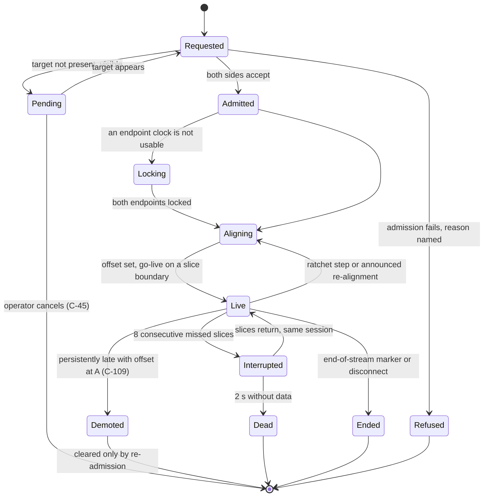

# 012 — Admission handshake

**Phase:** P3 · **Scope:** L (30 tickets, about 31.5 days) · **Depends on:** 004, 005, 007, 009, 010, 011 · **Blocks:** 014, 015, 017, 026, 028, 018, 023

## Goal

Implement, in `hadronyche-core` as pure `no_std` state machines, the two-sided admission handshake and the per-connection state machine: capacity checks in the settled units, explicit refusal with a named reason, the path-MTU probe pair, pinned destinations, the reverse measurement port, presentation-group required E, the per-connection regime-stamp record, and the connection life cycle from Requested to Dead or Ended.

## Background

**Product frame.** Hadronyche Medianets are wired, isolated LANs whose only traffic is this runtime's. Modules (sources, processors, sinks) exchange *slices* addressed by *position* on a domain-wide timeline. Linux hosts are the backbone; macOS and Windows machines are edges; embedded devices are followers. Because all traffic on a medianet is the runtime's own, all traffic is admitted traffic, and per-interface sums are enforceable. The network layer is IPv4 only, multicast with TTL 1 (C-100). Every stream on the wire runs at the 96 kHz domain rate (C-01); an edge whose hardware runs at 48 kHz converts at the edge (C-80), so admission never sees another rate.

**Evidence tags.** `[code]` read in the POC · `[measured]` · `[kernel-doc]` documented · `[memory]` · `[standard]` cited from a named published standard with the clause, replacing `[memory]` once checked (C-132) · `[decision]` design choice. The tags are defined in `00-context.md`; values computed from other constants are marked "derived".

**Settled since the ticket split.** These rulings of the constants table answer questions this epic or its tickets left open:

- Session number (C-19): the source assigns it, one per stream, and bumps it on restart and on timeline epoch change; every consumer of a stream sees the same value. The request therefore carries the source's current session of each requested stream; admission never allocates a session.
- Pending (C-45): no timeout. Pending persists until the target appears or the operator cancels, and is shown as unsatisfied in the graph view.
- Skew budget (C-96): the skew budget of a consumer is its presentation group's audition offset A (C-55, one per group, proposed by commissioning); alignment rings are sized to A. Buffer memory for a bundle subset follows: the receiver computes it from the members it subscribes, as subscribed member streams × slices spanned by A (rounded up) × audio bytes per slice (1 152 at defaults, C-04). Check against C-27: 16 members × 20 slices × 1 152 bytes = 368 640 bytes, about 370 KB at 10 ms (derived).
- Required E carrier (C-103): the sink declares its certified E, or declares E unknown. Both the sink's E and the group's required E travel in the consumer's manifest. A sink with unknown E is refused with `RequiredEExceeded` from any group that sets a required E and admitted to groups that set none.
- `FollowerCap` (C-35, C-114): the named refusal of a 65th follower by a clock holder (at most 64 followers per holder). This epic owns the reason code and the check; the 64-follower load and the 65th refusal are tested with synthetic followers. The value 64 is decided but its owner is now L1 (task 019), which checks that holder serving lateness does not grow below 64 followers (C-35, measured as in C-167); a change of the value is a one-constant change here.
- `ModuleCap` value (C-34): at most 64 active modules per medianet; commissioning refuses more.
- Refusal reasons, completed (C-185): 18 in all. `ControlDegraded` and `NoSkewBudget` are added to the 16 of C-173. `VersionMismatch`, `NameTaken` and `ModuleCap` are raised at discovery, where they stop a module joining, not at admission; the admission engine never produces them.
- Cost bound unit (C-106): counted abstract operations per slice, identical on every machine. The receiver converts with its calibration factor (time per operation), recorded in its regime stamp, before comparing with its per-slice CPU budget.
- Regime stamp (C-18, C-47, C-159): the stamp is a dedicated control message split into sections that each fit C-17, multicast on any regime change and every 10 s; the hello carries only a stamp version. The path MTU of each connection and the per-connection counters go in each side's stamp. C-159 completes the C-47 list: received, late, missing, marked gap, other-epoch (C-135), too-early, duplicates, incomplete reassemblies, demoted rounds, interrupted events, dead; plus the observed DSCP (C-47). Receiver reports are not multicast and there is no query message. Sending the stamp message is the hosted backend's duty (epic 015, C-144); this epic supplies the per-connection records.
- Persistently late (C-101): at least one late slice in each of 10 consecutive 1 s windows; this is the C-54 dwell expressed as a test. It is measured on the data plane (epic 009) and arrives as `RatchetStep` evidence; the aligning duration (C-50) likewise arrives as `AligningDone`. Neither timer runs in this epic.
- Demotion (C-109): an input persistently late with the offset already at A enters the health state Demoted: treated as gapped, counted separately, cleared only by re-admission.
- Miss counting (C-102, C-111, C-135): only slices absent at the deadline (missing or late) count toward the interrupted threshold; a marked gap or a slice on another timeline epoch resets the count. The dead threshold counts 2 s from the last slice received with content or a marked gap; a slice on another timeline epoch also restarts it and has its own per-connection counter (C-135). Epic 009 applies these rules before delivering evidence.
- Laptop sleep (C-124): sleep is a departure. Both timebase loops are reset, and on wake the edge returns through normal admission (Admitted, Locking, Aligning).
- Path-MTU probe size (C-116): the probe pair is exempt from the control message bound C-17; the probe is sent at the intended media packet size.
- Header cap (C-137): a default slice fits 1 252 bytes of UDP payload (1 152 bytes of audio plus at most 100 bytes of headers and checksum), so at defaults the intended media packet fits the 1 280-byte fallback; packets above 1 280 bytes exist only for non-default slice sizes.
- `PathMtuTooSmall` (C-173): applies when the probe at the 1 280-byte fallback also fails.
- Domain (C-173): a hello with domain 0 is ignored and counted, not refused; `ForeignDomain` is for a peer in a different non-zero domain.
- Member list (C-173): a 16th refusal reason, `BadMemberList`, covers an unknown or duplicate bundle member or more than 32 members. Such a request is decoded and refused, not dropped as malformed.
- Controller member (C-08, C-181, C-205, C-209): a bundle source's controllers always ride in their own member stream, and that member counts towards the 32 of C-08, so a source with controllers has at most 31 audio members. The admission member check counts it like any other member; rejecting a wider source with controllers is the compiler's, at compile time. A single-stream source (C-181, revised: permissive) may always put its controllers in a second stream, must do so when headers plus controllers exceed the 100-byte cap (C-137), and may share the audio packet while they fit; the compiler checks this from the manifest. Admission accepts either layout and never judges it: a controller stream is a member like any other.
- Wire cost of a controller stream (C-219): computed like an audio stream, one packet per slice of (headers up to the 100-byte cap + controller bytes per slice + 66 bytes of Ethernet, IP and UDP overhead), at 2 000 packets/s. Admission checks a controller member's bit/s and packets/s at this figure, the same one the commissioning tool uses.
- Alarms (C-173, C-174): a connection alarm is raised on refusal, interrupted, dead, demoted, cannot-meet-A and control-degraded. "Cannot meet A" is maximum lateness + D + headroom above A in each of 10 consecutive 1 s windows; epic 009 judges it over the rolling 60 s window of C-182 and delivers it as evidence.
- Satisfied (C-154): only Live counts as satisfied in the graph view. Pending, Locking, Aligning, Interrupted and Demoted are shown by name as unsatisfied; so are Requested, Admitted, Refused, Dead and Ended.
- Numeric E (C-140): only a commissioned sink declares a numeric E; uncertified and self-monitored sinks declare E unknown (C-103).
- Unlocked sink (C-180): a commissioned sink whose clock is unlocked stays commissioned and keeps its numeric E, so the required-E check is unchanged; its alignment claim is suspended until the clock locks again, which the connection already reflects by waiting in Locking, and it resumes without re-commissioning.
- Required-E refusal (C-194): a sink is refused on its own declared E against the group's required E, whatever the E of the other sinks in the group; the check never compares sinks.
- Fan-in outside any presentation group (C-142): a consumer with aligned inputs that belongs to no group inherits the A of the downstream presentation group it feeds (the largest if several), learned at admission. With no downstream group it needs an explicit budget in configuration, or its aligned inputs are refused, with `NoSkewBudget` (C-185). Inputs opted out of alignment by operator policy (C-165) are not aligned inputs.
- A changed while inputs are live (C-186): every fan-in that inherited the old A re-enters aligning at an announced position, with rings and ratchet ceiling resized, as the sinks do.
- Re-alignment position after a changed A (C-208): each fan-in that learns of the change picks its own position, one lead (C-43) ahead, and announces it in its own output, as for a ratchet-triggered re-alignment. That is epic 009's; this epic sees it only as `AnnouncedRealign` evidence.
- A larger than a fan-in's buffer memory (C-211): the commissioning tool (epic 028) checks declared buffer memory before applying a change of A. If one reaches a fan-in anyway, it keeps the deepest ring it can hold as its ceiling, raises the cannot-meet-A alarm (C-174) and keeps its streams running. In this epic the re-budget path caps the published figure and raises the alarm instead of refusing or tearing down (ticket 012-29).
- A clamped A in detail (C-216): the cannot-meet-A alarm stays raised until a later change of A that fits; the fan-in's receiver report (C-198) carries the A it was given, not the clamped value, so upstream modules size themselves to what the sinks need (ticket 012-29).
- Where a sink switches to a changed A (C-214): at its own position, one lead (C-43) ahead, as a fan-in does (C-208); it has nobody to announce it to. Picking the position is epic 009's; in this epic a change of the sink's own group A re-budgets its aligned inputs through the same queue as a fan-in, and the state changes only on data-plane evidence (ticket 012-30).
- Who the clamp of C-211 applies to (C-222): any consumer that buffers to meet A, sinks included; C-216 applies to a sink in the same way. A sink's own changed A that needs more buffer memory than it holds is capped, alarmed and held exactly as for a fan-in (tickets 012-29, 012-30).
- How a commissioned change of a sink's own A reaches the sink (C-224): through the commissioning tool, inside a declared window (C-153): the tool validates buffer memory first (C-211) and then announces the new A to the group's members. The engine receives the announced value through `set_group_a_ns`; the announcement message is the commissioning tool's (epic 028) (ticket 012-30).
- Carrier of a changed A upstream (C-198): the receiver report (C-40) carries the consumer's current A, its own or the one it inherited. A change propagates one hop per report, on the data plane, and each fan-in that inherited the old value re-aligns (C-186).
- Housekeeping restart limit (C-139): after 5 panics within 60 s the module stays control-degraded with an alarm; its live streams continue and it accepts no new connection until an operator restarts it. The restart criterion itself belongs to epic 015 (C-144); this epic provides the gate. A request reaching a control-degraded module is refused with `ControlDegraded`, answered by the housekeeping supervisor, which keeps a minimal refusal path (C-185).
- Commissioning window (C-153, C-178): while a window is open, ordinary production measurements in stamps (latency, loss, alignment figures) are unqualified. The window is announced by the tool and stamped by each module while open; the per-connection records of this epic carry no flag of their own and their counters are neither reset nor suppressed.
- Lock state (C-187): the servo core (epic 008a) publishes each module's clock lock state and bound through the published time view; it reaches this epic only as `ClockUsable` evidence from epic 009. Who aggregates both endpoints for Locking → Aligning stays with epic 005.
- Conformance vectors (C-192, C-193): epic 005 supplies the state tables and scenario scripts for admission and connection, epic 004 the wire layouts and reject reasons; the vectors crate sits at the workspace root and the fuzzing tool is the implementing team's choice.
- Sink-only device (C-168): its liveness is judged by the producer timeout (C-41); interrupted and dead describe streams a peer receives.
- Drain cycle (C-156): the cycle of the C-16 bound is one slice period.
- Bad input bound (C-164, proposal pending L1): processing one bad input is linear in packet length and at most 10 µs per packet; this applies to the handshake decoder.
- Privileged tests (C-146): the "unprivileged" definition-of-done line applies to per-change CI; no test in this epic needs a privilege.
- Structural latency and resamplers (C-104, C-105, C-134, C-183, C-189, C-190, C-197, C-207, C-210) concern the DSL compiler, the arithmetic kit and edge modules; admission carries no latency figure and needs no change.
- No subject in this epic: seqlock safety and pins (C-177, C-201, module start-up); the redundancy decision (C-179); transport state and tempo (C-141, C-184, C-199, C-200); holdover (C-169, C-195); the holder's sync service (C-188, C-204; `FollowerCap` keeps its check here); ladder test parameters (C-191, C-202, C-203, C-212); dependency hygiene of specification epics (C-196). Presentation details of the commissioning tool that shows the graph view are epic 028's (C-206); this epic fixes only the graph-view structure.
- Control message authentication (C-12, C-115): every handshake message carries the reservation with scheme 0 and a zero tag; the 64-bit counter is live because it is the liveness counter.
- Fuzz budget (C-95): each parser runs 60 s on every change and 1 hour nightly; the corpus is kept.
- Trunks (C-117): declared trunk capacity is per direction; trunk feasibility stays with the commissioning tool.
- Where outputs live (C-130, C-133): task outputs go in the design set's repository. The admission specification goes in `doc/design/spec/`; the operator reference for refusal reasons, connection states and alarms goes in the operator guide in `doc/operations/` (C-171); behaviour changes to the architecture go in `doc/design/01-architecture.md` (C-171); new constants go in `doc/design/02-constants.md`. Test code stays with `hadronyche-core`; any harness or tool binary goes in the `hadronyche-tools` crate. Nothing is written into the frozen POC tree.
- Strict mode and capability states (C-127 to C-129, C-131) concern module start-up and the regime stamp's capability section, not stream admission; this epic neither checks nor stamps them.

### Constants `[decision]` unless marked

| Id | Constant | Value |
|---|---|---|
| C-01 | Domain sample rate | 96 000 Hz, the only rate on the wire |
| C-02 | Slice length (default) | 48 frames = 0.5 ms = 2 000 slices/s (inherited) |
| C-04 | Channels per stream at defaults | 6; 192 bytes per channel per slice, 1 152 bytes of audio; no per-channel id byte |
| C-20 | Wire size of one default packet | about 1 320 bytes including all Ethernet overhead (derived) |
| C-21 | Wire rate per stream | about 21.1 Mbit/s, about 3.5 Mbit/s per channel (derived) |
| C-22 | Wire rate per source | 24 ch: 4 streams, 84 Mbit/s, 8 000 packets/s. 48 ch: 8 streams, 169 Mbit/s, 16 000 packets/s. 96 ch: 16 streams, 338 Mbit/s, 32 000 packets/s (derived) |
| C-23 | Admission ceiling | 70 % of the link rate |
| C-24 | GbE port wall | about 198 channel-copies per port (8 × 24 ch, 4 × 48 ch or 2 × 96 ch) (derived) |
| C-25 | 10 GbE trigger | any port carrying more than about 198 channel-copies |
| C-26 | 100 Mbit device port | about 19 channels (derived) |
| C-27 | Alignment buffer per 16-member bundle | about 370 KB at a 10 ms skew budget (derived) |
| C-05 | Default slice size | fits one packet at the path MTU; multi-packet slices are an explicit, stamped regime |
| C-06 | Path-MTU fallback | 1 280 bytes, giving 1 252 bytes of UDP payload over IPv4 (C-100) |
| C-08, C-209 | Members per bundle | at most 32, the controller member included; a source with controllers has at most 31 audio members |
| C-181 | Where controllers travel (revised: permissive) | a bundle source's in their own member stream; a single-stream source may always use a second stream, must above the 100-byte cap, may share the audio packet while they fit; checked by the compiler |
| C-219 | Wire cost of a controller stream | like an audio stream: one packet per slice of (headers up to 100 bytes + controller bytes per slice + 66 bytes overhead), 2 000 packets/s; same figure in admission and the commissioning tool |
| C-11 | Module id / instance nonce / domain id | 64 / 64 / 16 bits; domain 0 = unconfigured |
| C-12, C-115 | Authentication reservation | scheme 8 bits + counter 64 bits + tag 128 bits; in v1 scheme 0, tag zero, counter live |
| C-16, C-156 | Bounded drain per input per cycle | 2 × the admitted packets per slice; the cycle is one slice period |
| C-17 | Control message size bound | at most 1 252 bytes of UDP payload |
| C-18 | Regime stamp transport | dedicated sectioned control message, multicast on change and every 10 s; hello carries only the stamp version |
| C-19 | Session number ownership | source-assigned, one per stream; bumped on restart and on timeline epoch change |
| C-34 | Active modules per medianet | at most 64 |
| C-35 | Followers per holder | at most 64; excess refused with a named event (owner L1, task 019) |
| C-38 | Interrupted | 8 consecutive missed slices (4 ms) |
| C-39 | Dead | 2 s without data |
| C-40 | Receiver report | one per bundle every 100 ms |
| C-41 | Producer timeout | 2 s without receiver reports |
| C-45 | Pending timeout | none; persists until the target appears or the operator cancels |
| C-47 | Third-party stream health | per-connection summary counters in each side's regime stamp |
| C-50 | Aligning duration | 4 s |
| C-53 | Ratchet step | one slice period; ceiling is A |
| C-54 | Dwell before automatic re-alignment | 10 s |
| C-55 | Audition offset A | no default; one per presentation group; proposed by commissioning |
| C-92 | Two-bundle capacity test | one Linux consumer on one GbE port aligns 2 × 96 channels (32 streams, 64 000 packets/s, 676 Mbit/s); a third bundle is refused (pending-measurement, L1) |
| C-95 | Fuzz budget | each parser 60 s on every change and 1 hour nightly; corpus kept |
| C-96 | Skew budget cap | the presentation group's A; rings sized to A |
| C-100 | IP version | IPv4 only; multicast TTL 1 |
| C-101 | Persistently late | a late slice in each of 10 consecutive 1 s windows |
| C-102 | Miss for C-38 | missing or late at the deadline; marked gap or other-epoch slice resets the count |
| C-103 | Sink with no certified E | E unknown; refused from groups that set a required E |
| C-106 | Cost bound unit | abstract operations per slice; per-target calibration factor in the regime stamp |
| C-109 | Demotion at the ratchet ceiling | health state Demoted, cleared only by re-admission |
| C-111 | Start of the dead threshold | last slice received with content or a marked gap |
| C-135 | Slice on another timeline epoch | restarts the dead clock, is not a miss, has its own counter |
| C-137 | Header cap | a default slice fits 1 252 bytes of UDP payload: 1 152 bytes of audio + at most 100 bytes of headers and checksum |
| C-139 | Housekeeping restart limit | after 5 panics within 60 s: control-degraded with an alarm, live streams continue, no new connection until an operator restart |
| C-140 | Numeric E | commissioned sinks only; others declare E unknown |
| C-142 | Fan-in outside any presentation group | inherits the largest downstream group A, learned at admission; else an explicit configured budget, or aligned inputs are refused |
| C-154 | Satisfied in the graph view | only Live |
| C-159 | Per-connection stamp counters | received, late, missing, marked gap, other-epoch, too-early, duplicates, incomplete reassemblies, demoted rounds, interrupted events, dead |
| C-164 | Bound on processing one bad input | linear in packet length, at most 10 µs per packet (proposal, pending L1) |
| C-168 | Liveness of a sink-only device | judged by the producer timeout (C-41) |
| C-171 | More locations | architecture in `doc/design/01-architecture.md`; operator guide in `doc/operations/` |
| C-173 | Admission details | `PathMtuTooSmall` when the 1 280-byte probe also fails; domain 0 hello ignored and counted; `ForeignDomain` for another non-zero domain; 16th reason `BadMemberList`; alarm on refusal, interrupted, dead, demoted, cannot-meet-A, control-degraded |
| C-174 | "Cannot meet A" alarm | maximum lateness + D + headroom exceeds A in each of 10 consecutive 1 s windows |
| C-185 | Refusal reasons, completed | 18 in all: adds `ControlDegraded` (C-139, answered by the housekeeping supervisor's minimal refusal path) and `NoSkewBudget` (C-142) to the 16 of C-173; `VersionMismatch`, `NameTaken` and `ModuleCap` are raised at discovery, not at admission |
| C-186 | A changed while inputs are live | every fan-in that inherited the old A re-enters aligning at an announced position, with rings and ratchet ceiling resized, as the sinks do |
| C-198 | Carrier of a changed A upstream | the receiver report (C-40) carries the consumer's current A, its own or the one it inherited; a change propagates one hop per report, on the data plane, and each fan-in that inherited the old value re-aligns (C-186) |
| C-116 | Path-MTU probe size | exempt from C-17; sent at the intended media packet size |
| C-130 | Where task outputs live | specifications in `doc/design/spec/`, reports in `doc/design/reports/`, constants in `doc/design/02-constants.md` |
| C-132 | Evidence tag for a published standard | `[standard]`, with the clause |
| C-133 | Where tool code lives | probes in `probes/`, harness and tool binaries in the `hadronyche-tools` crate |
| C-124 | Laptop edge sleep | a departure; return through normal admission |
| C-180 | Commissioned sink with an unlocked clock | stays commissioned; alignment claim suspended until locked, resumes without re-commissioning |
| C-193 | Sources of the conformance vectors | epic 004: wire layouts and reject reasons; epic 005: state tables and scenario scripts for admission and connection |
| C-194 | Required-E refusal (AC-30) | on the sink's own declared E, whatever the other sinks' E |
| C-208 | Re-alignment position after a changed A | picked by each fan-in, one lead ahead, announced in its own output |
| C-211 | A larger than a fan-in's buffer memory | checked by the commissioning tool first; otherwise the fan-in keeps the deepest ring it can hold as ceiling, raises cannot-meet-A and keeps its streams running |
| C-214 | Where a sink switches to a changed A | at its own position, one lead ahead, as a fan-in does; not announced |
| C-216 | A clamped A, in detail | cannot-meet-A stays raised until a later change of A that fits; the receiver report carries the A given, not the clamped value |
| C-222 | Who the clamp of C-211 applies to | any consumer that buffers to meet A, sinks included; C-216 applies to a sink in the same way |
| C-224 | How a commissioned change of a sink's own A reaches the sink | through the commissioning tool, inside a declared window (C-153): buffer memory validated first (C-211), then the new A announced to the group's members |

### Handshake rules `[decision]`

- Connection is **two-sided**. The requester names a source output (or bundle members) and a consumer input; **both sides accept or refuse**.
- **Refusal is explicit and terminal, with a named reason.** No retry loop. "Target not present" is not a refusal: the request stays **Pending** and visible, with no timeout, until the target appears or the operator cancels it (C-45). A cancelled request leaves the desired set.
- The exchange carries: declared rates, the bundle member list with the source's current session of each requested stream (C-19), the path-MTU probe pair, the **reverse measurement port**, the **pinned addresses** (IPv4, C-100), and the manifest (ports, content types, and for presentation groups the **required E** and the sink's declared E or "unknown", C-103). Every handshake message carries the authentication reservation (C-115).
- **L-5:** destinations are pinned at admission and change only by re-admission. A hello with a new address never redirects a live stream.
- **L-4:** housekeeping admits unknown sources only; it never touches a live data path. Housekeeping passes peer-map changes to the engine through `on_peer_map`, which may only move Pending requests to Requested.
- An operator alarm is raised through the hello's alarm field, on refusal, interrupted, dead, demoted, cannot-meet-A and control-degraded (C-173, C-174). The graph is a desired set; the runtime publishes satisfied versus unsatisfied, and only Live is satisfied (C-154). There are no all-or-nothing groups in v1.
- A hello with domain 0 is ignored and counted, not refused; `ForeignDomain` refuses a peer in a different non-zero domain (C-173).
- An unknown or duplicate bundle member, or more than 32 members (the controller member included, C-209), is refused with `BadMemberList` (C-173).
- A control-degraded module (C-139) accepts no new connection until an operator restarts it; its admitted connections are untouched. Its housekeeping supervisor refuses each incoming request with `ControlDegraded` through a minimal refusal path (C-185).
- `VersionMismatch`, `NameTaken` and `ModuleCap` are raised at discovery, where they stop a module joining, not at admission (C-185).
- One handshake covers a bundle: it lists the members wanted; a narrow sink subscribes to only the members it needs.
- When the engine's connection table is full, `request` fails locally with `RequestError::TableFull` and sends nothing (no refusal reason, since no peer refused); a consumer with no free slot refuses an incoming request with `InputCount`.

### Units checked `[decision]`

| Unit | Checked by |
|---|---|
| bit/s on the wire, including headers (a controller member at the C-219 figure) | sender against its interface; receiver against its interface; ceiling 70 % |
| packets/s | receiver |
| slice rate | receiver |
| input count | receiver |
| buffer memory (A × rate of the subscribed members, C-96; outside a group, the inherited A or the configured budget, C-142) | receiver; decisive on embedded |
| compiler cost bound per slice (abstract operations, converted with the receiver's calibration factor, C-106) | receiver, for DSL modules |

CPU for non-DSL modules is a diagnostic (overrun counter and alarm), not admission. Trunk links are never computed by the runtime: endpoint admission is online and dynamic; trunk feasibility (capacity declared per direction, C-117) is validated offline by the commissioning tool. The per-platform limits for packets/s, slice rate, input count, buffer memory and CPU per slice are configuration inputs until measured (see open sub-questions).

### Path-MTU probe pair `[decision]`

At admission the two ends exchange a padded don't-fragment packet at the intended media packet size (exempt from C-17, C-116) and an acknowledgement. On a pure layer-2 path a too-small hop drops silently and sends no error back, so **silence is the answer only because an acknowledgement is expected**. On failure, probe again at the 1 280-byte fallback (1 252 bytes of UDP payload, C-100); a slice that no longer fits one packet then needs the explicit multi-packet regime (C-05). If the probe at 1 280 bytes also fails, the request is refused with `PathMtuTooSmall` (C-173). At defaults the media packet fits 1 280 bytes (C-137), so the first probe is already at or below the fallback size. Re-probe when large packets vanish while liveness holds. The path MTU of each connection goes in the regime stamp (C-18). The probe timeout and the re-probe thresholds are open sub-questions.

### Presentation groups `[decision]`

A sink belongs to a presentation group with an operator-configured audition offset A (C-55) and a **required E**. E is the 99.9th percentile of absolute emission error over a one-hour certification run (C-73). A sink whose E exceeds the group's required E is refused at admission with a named reason. A sink with no certified E declares E unknown and is refused with `RequiredEExceeded` from any group that sets a required E; it is admitted to groups that set none (C-103). Only a commissioned sink declares a numeric E; uncertified and self-monitored sinks declare E unknown (C-140); a commissioned sink whose clock is unlocked keeps its numeric E and waits in Locking (C-180). The check uses the sink's own E only, whatever the other sinks' E (C-194). The group's A is the skew budget of its consumers (C-96). A consumer with aligned inputs outside any group inherits the largest A of the downstream groups it feeds, learned at admission: each accept carries the group A that applies at the consumer (its own group's, or the one it inherited), and a module takes the largest over its admitted output connections. With no downstream group it uses an explicit budget from configuration, or its aligned inputs are refused with `NoSkewBudget` (C-142, C-185). When the A a fan-in inherited changes while its inputs are live, each such input re-enters Aligning at an announced position, with rings and ratchet ceiling resized, as the sinks do (C-186): the engine publishes the new A per input, and the transition arrives as `AnnouncedRealign` evidence from epic 009, so L-1 holds; the position is picked by the fan-in itself, one lead ahead (C-208). If the new A needs more buffer memory than the fan-in holds, it keeps the deepest ring it can hold as ceiling, raises the cannot-meet-A alarm and keeps its streams running (C-211); the alarm stays raised until a later change of A that fits, and the fan-in's receiver reports carry the A it was given, not the clamped value (C-216). A sink whose own group's A changes switches at its own position, one lead ahead, unannounced (C-214). A commissioned change of a sink's own A reaches it from the commissioning tool, inside a declared window, after the tool has validated buffer memory, as an announcement to the group's members (C-224); if one needs more buffer memory than the sink holds anyway, the sink is clamped exactly as a fan-in (C-222, C-211, C-216). A change after admission reaches the fan-in in the receiver reports (C-40) of its downstream consumers, which carry each consumer's current A, own or inherited; it propagates one hop per report, on the data plane (C-198).

### Connection states `[decision]`



- **L-1:** a live connection becomes dead only from data-plane evidence. Gossip silence never tears it down. Reverse direction: the producer stops only after 2 s without receiver reports.
- A locking member is present but not live: its inputs to others are declared silent, not gaps, not loss.
- Go-live is the consumer's local decision, on a slice boundary, flagged on the first slice.
- Resuming from Interrupted is immediate at the frozen offset.
- A Demoted connection's input is treated as gapped and counted separately (C-109). Exits from Demoted other than re-admission (silence, end of stream) are taken from epic 005's tables.
- Sleep of an edge is a departure (C-124): its connections end (Ended on an announced disconnect, otherwise Dead from data-plane silence under L-1), and on wake each connection passes a fresh admission through Admitted, Locking and Aligning.
- The evidence variants are: clock usable, aligning done, missed slices, resumed, silent for 2 s, end of stream, disconnect, ratchet step, announced re-alignment, demoted, cannot meet A (C-174, alarm only, no transition), large packets vanished, and reports silent for 2 s. Epic 009 produces them under C-101, C-102, C-111, C-135 and C-174.
- A sink-only device is judged live by the producer timeout only (C-168): on its producer-side connections `ReportsSilentFor2s` is the liveness evidence.

### Receive-side enforcement the handshake sets up `[decision]`

The source filter (only admitted peers are parsed), the bounded drain per input (C-16, per slice period, C-156), and the socket buffer sized to the declared rate times the skew budget A (C-96), whose per-socket overflow counter is read on every receive `[kernel-doc]`.

`[code]` Retired POC behaviour: the output owner resolves the target's address from the gossip map and starts sending without the receiver's consent (`module.rs:775-820`); a missing target is waited for indefinitely (`"{to}?"` labels); the only refusals are content-type mismatch and "not an input"; routes are rebuilt when a peer's hello shows a new address (`module.rs:542`).

## Deliverables

All in `hadronyche-core`, `no_std`, no allocation.

```rust
// shape, names may be refined
pub type Addr = SocketAddrV4;                                                   // IPv4 only (C-100)
pub struct Request<'a> {
    pub source: ModuleId, pub output: PortRef, pub members: &'a [StreamId],   // empty = whole output
    pub sessions: &'a [u32],                       // source-assigned, one per requested stream (C-19)
    pub consumer: ModuleId, pub input: PortRef,
    pub declared: Declared, pub intended_packet_bytes: u16,
}
pub struct Declared {
    pub wire_bits_per_s: u64, pub packets_per_s: u32, pub slices_per_s: u32,
    pub buffer_bytes: u32,                         // for the listed members only (C-96)
    pub cost_bound_ops: Option<u32>,               // abstract operations per slice (C-106)
}
pub struct PresentationTerms {                     // in the consumer's manifest
    pub required_e_ns: Option<u32>,                // None = the group sets no required E
    pub sink_e_ns: Option<u32>,                    // None = E unknown (C-103)
}
pub struct Accept {
    pub pinned_source: Addr, pub pinned_dest: Addr, pub reverse_port: u16, pub path_mtu: u16,
    pub group_a_ns: Option<u32>,                   // A of the group that applies at the consumer, own or inherited (C-142)
}
#[repr(u8)]
pub enum RefuseReason {
    PortCeiling, PacketRate, SliceRate, InputCount, BufferMemory, CostBound,
    ContentMismatch, NotAnInput, VersionMismatch, ForeignDomain,
    PathMtuTooSmall, RequiredEExceeded, FollowerCap, ModuleCap, NameTaken,
    BadMemberList,                                 // 16th reason (C-173)
    ControlDegraded, NoSkewBudget,                 // 17th and 18th (C-185)
}   // VersionMismatch, NameTaken, ModuleCap: raised at discovery, not at admission (C-185)

pub struct PortBudget { pub link_bits_per_s: u64, pub committed_bits_per_s: u64 }
impl PortBudget {
    pub const CEILING_PERMILLE: u16 = 700;
    pub fn can_admit(&self, extra_bits_per_s: u64) -> bool;
}

pub struct Admission<const CONNS: usize> { /* both roles */ }
impl<const CONNS: usize> Admission<CONNS> {
    pub fn request(&mut self, now_ns: i64, req: Request<'_>, map: &PeerMap, out: &mut Outbox) -> Result<ConnId, RequestError>;
    pub fn cancel(&mut self, conn: ConnId) -> Option<ConnEvent>;                     // Pending only (C-45)
    pub fn on_message(&mut self, now_ns: i64, from: Addr, bytes: &[u8], out: &mut Outbox) -> Option<ConnEvent>;
    pub fn on_peer_map(&mut self, now_ns: i64, map: &PeerMap, out: &mut Outbox) -> Option<ConnEvent>; // Pending re-check
    pub fn on_tick(&mut self, now_ns: i64, out: &mut Outbox) -> Option<ConnEvent>;      // MTU probe timeout
    pub fn on_data_plane(&mut self, conn: ConnId, ev: DataPlaneEvidence) -> Option<ConnEvent>;
    pub fn on_counters(&mut self, conn: ConnId, c: GapCounters);                        // C-47, C-159, from epic 009
    pub fn stamp_records(&self) -> impl Iterator<Item = ConnStampRecord>;               // C-18, C-47, C-159
    pub fn set_control_degraded(&mut self, on: bool) -> Option<ConnEvent>;              // C-139, driven by epic 015
    pub fn set_configured_skew_budget(&mut self, ns: Option<u32>);                      // C-142, from configuration
    pub fn report_a_ns(&self) -> Option<u32>;                                            // A to place in receiver reports, own or inherited (C-198)
    pub fn on_report_a(&mut self, conn: ConnId, a_ns: Option<u32>);                     // A from a received receiver report (C-198)
    pub fn a_clamped(&self, conn: ConnId) -> bool;                                       // cannot-meet-A held while A is clamped (C-211, C-216)
    pub fn set_group_a_ns(&mut self, ns: Option<u32>);                                   // own group's A from configuration (C-55) or announced by the commissioning tool (C-224); a change re-budgets (C-214), clamped as 012-29 (C-222)
}
pub enum RequestError { TableFull, ControlDegraded }                                  // local failures, nothing sent
pub enum DataPlaneEvidence { ClockUsable(bool), AligningDone { offset_ns: i64 }, MissedSlices(u32),
                             Resumed, SilentFor2s, EndOfStream, Disconnect, RatchetStep, AnnouncedRealign,
                             Demoted, CannotMeetA, LargePacketsVanished, ReportsSilentFor2s }   // CannotMeetA: C-174
pub enum ConnState { Requested, Pending, Refused(RefuseReason), Admitted, Locking, Aligning,
                     Live, Interrupted, Demoted, Dead, Ended }
pub enum ConnEvent { State(ConnId, ConnState), ProducerStopped(ConnId), Alarm(ConnId) }
pub struct GapCounters { pub received: u64, pub late: u64, pub missing: u64, pub marked_gap: u64,   // C-159
                         pub other_epoch: u64, pub too_early: u64, pub duplicates: u64,
                         pub incomplete_reassemblies: u64, pub demoted_rounds: u32, pub dscp: u8 }
pub struct ConnStampRecord { pub conn: ConnId, pub path_mtu: u16, pub state: ConnState,
                             pub counters: GapCounters, pub interrupted_events: u32, pub dead: bool }

pub struct MtuProbe { /* padded DF packet at the intended size + ack, timeout, fallback 1280 */ }
```

Plus scenario-vector tests, a fuzz target for handshake messages, and a published "graph view" structure listing every wanted connection with its state and refusal reason.

## Dependencies

- Needs from 004: handshake message layouts, the authentication reservation layout, the regime-stamp section layout, and the wire layouts and reject reasons for the conformance vectors (C-193). From 005: the transition tables and the admission and connection scenario scripts (C-193). From 007: the vectors crate (at the workspace root, C-192). From 009: Interrupted, Dead, ratchet, Demoted, cannot-meet-A and aligning-done evidence, applied under C-101, C-102, C-111, C-135 and C-174, and the per-connection counters (C-47, C-159). From 015: the control-degraded signal (C-139, C-144), and the housekeeping supervisor that runs the minimal refusal path (C-185). From 009 also: the announced re-alignment, ring and ratchet-ceiling resizing when a fan-in's inherited A changes (C-186), and the receiver reports that carry each consumer's current A, sent with the value from `report_a_ns` and passed back through `on_report_a` (C-198). From 010: `wire_bits_per_second` (a controller stream at the C-219 figure), packets/s, member lists. From 011: the peer map and capability bits.
- Provides to 014: the reverse port and the source's session of each admitted stream. To 015: the machine housekeeping drives (including `on_peer_map` and `set_control_degraded`), the stateless `ControlDegraded` refusal function for the supervisor (C-185), the new A of each fan-in input whose inherited A changed (C-186), the source-filter entries, the socket-buffer sizes and the per-connection stamp records it sends (C-144). To 017: connections for the reference graph. To 026: the same code on the device. To 028: the graph view, the refusal reasons and the per-connection stamp records for the commissioning tool.

## Acceptance criteria

1. **012-A1 (AC-1):** all admission and connection scenario vectors pass.
2. **012-A2 (AC-12):** a request that would take a port above 70 % of its rate is refused with `PortCeiling`; the graph view shows the connection unsatisfied with that reason; no retry occurs. Concretely, on a GbE port a third 96-channel bundle (338 Mbit/s each) is refused after two are admitted (676 Mbit/s, 64 000 packets/s, C-92).
3. **012-A3:** every `RefuseReason` this epic raises is produced by at least one test; `FollowerCap` through the C-35 check with synthetic followers (C-114). `VersionMismatch`, `NameTaken` and `ModuleCap` are raised at discovery (C-185), and no admission test produces them.
4. **012-A4 (AC-30):** a sink whose declared E exceeds the group's required E is refused with `RequiredEExceeded` on its own figure, whatever the other sinks' E (C-194), and never reaches Live in the group; a sink with unknown E is refused from a group that sets a required E and admitted to a group that sets none (C-103).
5. **012-A5 (AC-19, core part):** with size-dependent drop injected, the probe pair fails, the connection is admitted at 1 280 bytes, and the path MTU is exposed for the stamp; when the 1 280-byte probe also fails the request is refused with `PathMtuTooSmall` (C-173); re-probe triggers when large packets vanish while liveness holds.
6. **012-A6 (AC-20 d):** a hello with a changed address during Live changes nothing in the pinned addresses.
7. **012-A7 (AC-20 a):** 30 s of hello silence leaves every Live connection Live.
8. **012-A8 (AC-16):** Live → Interrupted after exactly 8 consecutive missed slices; Interrupted → Live immediately when slices return on the same session; Interrupted → Dead at 2 s.
9. **012-A9 (AC-21, producer side):** the producer stops after 2 s without receiver reports.
10. **012-A10 (C-45):** "target not present" yields Pending, visible and unsatisfied in the graph view, with no timeout; it becomes Requested when the target appears; an operator cancel removes it from the desired set.
11. **012-A11:** compiles for a `no_std` target without an allocator.
12. **012-A12 (C-109):** a Live connection persistently late with its offset at A becomes Demoted, is shown with that state, and leaves it only through re-admission.
13. **012-A13 (C-18, C-47, C-159):** each admitted connection exposes a stamp record with its path MTU, every C-159 counter (received, late, missing, marked gap, other-epoch, too-early, duplicates, incomplete reassemblies, demoted rounds, interrupted events, dead) and the observed DSCP, on both the producer and the consumer side.
14. **012-A14 (C-19):** the request carries the source's session of each requested stream; two consumers of one stream record the same session.
15. **012-A15 (C-124):** an edge that sleeps departs; on wake its connection passes a fresh admission through Admitted, Locking and Aligning.
16. **012-A16 (C-154, C-173, C-174):** only Live is shown satisfied in the graph view; an alarm is raised on refusal, interrupted, dead, demoted, cannot-meet-A and control-degraded, and on no other event.
17. **012-A17 (C-142):** a fan-in consumer outside any presentation group sizes its aligned inputs to the largest A of the downstream groups it feeds, learned at admission; with no downstream group and no configured budget its aligned inputs are refused with `NoSkewBudget` (C-185); when its inherited A changes, each affected input is given the new A and re-enters Aligning only on announced re-alignment evidence (C-186); a change of a downstream A after admission arrives in receiver reports, one hop per report (C-198).
18. **012-A18 (C-139, C-185):** a control-degraded module accepts no new connection, refuses an incoming request with `ControlDegraded` (also through the supervisor's stateless refusal path), keeps its admitted connections unchanged, and raises the control-degraded alarm.
19. **012-A19 (C-211):** when a changed inherited A needs more buffer memory than a fan-in holds, its affected inputs keep running, their ring ceiling is capped at the deepest the buffer holds, the cannot-meet-A alarm is raised and stays raised until a later change of A that fits, the fan-in's receiver reports keep carrying the A it was given, not the clamped value (C-216), and no input is refused or torn down.
20. **012-A20 (C-214):** when a sink's own group A changes, each of its aligned inputs sized to that A is given the new A, stays in its state until data-plane re-alignment evidence moves it to Aligning, and no state changes from the configuration call; a new A beyond the sink's buffer memory is capped, alarmed and held as in 012-A19 (C-222, C-216).

## Definition of done

- [ ] Tests green in CI, unprivileged
- [ ] Every parser touched is fuzzed
- [ ] Regime stamp fields touched are complete and documented
- [ ] Design documents updated where behaviour differs, constants table first
- [ ] No new open item without an owner and a falsifier
- [ ] The frozen POC is not modified (task 003 is the only exception)
- [ ] Every new factual claim carries an evidence tag
- [ ] No transition out of Live or Interrupted is reachable from a gossip input (test and table inspection)
- [ ] Refusal reasons and connection states are documented for operators

Not applicable in this epic (C-125): none. Every line has a subject here: the handshake decoder is the parser, the path MTU and the C-47 per-connection summary are the stamp fields, and the connection states and refusal reasons are the operator-facing subject.

## Open sub-questions

| Question | Owner | Falsifier |
|---|---|---|
| How does a module learn its link rate on each platform (and on a device)? | Tasks 015, 021, 022, 026 | A platform cannot report it; the rate becomes operator configuration there |
| Pending timeout for "target not present" | Decided (C-45): none; Pending persists until the target appears or the operator cancels, and is shown as unsatisfied | — |
| How is buffer memory declared for a bundle subset? | Decided (C-96, with C-04 and C-27): the receiver computes subscribed members × slices spanned by A × audio bytes per slice | — |
| Does the sender or the consumer own the session number? | Decided (C-19): the source assigns it, one per stream, and bumps it on restart and on timeline epoch change | — |
| Re-probe heuristic thresholds | This task proposes (ticket 012-10); L1 (task 019) confirms | A blackhole persists undetected, or re-probes fire on ordinary loss |
| Path-MTU probe timeout value | This task proposes (ticket 012-09); L1 (task 019) confirms | Probes on a healthy path time out, or a failed probe delays admission beyond what operators accept |
| When does `PathMtuTooSmall` apply, given the 1 280-byte fallback and the multi-packet regime (C-05)? | Decided (C-173): when the probe at the 1 280-byte fallback also fails | — |
| Exact conditions for `VersionMismatch`, `NameTaken` and `ModuleCap` at admission time | Decided (C-185): they are raised at discovery, where they stop a module joining, not at admission. `ForeignDomain` is decided (C-173): a different non-zero domain; a domain 0 hello is ignored and counted | — |
| Refusal reason for an invalid member list | Decided (C-173): `BadMemberList` for an unknown or duplicate member or more than 32 members | — |
| Skew budget of a consumer that belongs to no presentation group | Decided (C-142): the largest A of the downstream groups it feeds, learned at admission; else an explicit configured budget, or its aligned inputs are refused | — |
| Which `RefuseReason` refuses an aligned input of a fan-in with no downstream group and no configured budget, and what happens to its rings when the inherited A changes after its inputs were admitted | Decided (C-185, C-186): `NoSkewBudget`; each input that inherited the old A re-enters aligning at an announced position, with rings and ratchet ceiling resized | — |
| How a change of a downstream group's A after admission reaches an upstream fan-in that inherited it (C-142 learns A at admission; C-186 names no carrier) | Decided (C-198): the receiver report (C-40) carries the consumer's current A, own or inherited; a change propagates one hop per report, on the data plane, and each fan-in that inherited the old value re-aligns (C-186) | — |
| What a requester sees when its request reaches a control-degraded module | Decided (C-185): refused with `ControlDegraded`, answered by the housekeeping supervisor's minimal refusal path | — |
| Satisfied or unsatisfied for Locking, Aligning, Interrupted and Demoted | Decided (C-154): only Live is satisfied | — |
| Which events raise `ConnEvent::Alarm` | Decided (C-173, C-174): refusal, interrupted, dead, demoted, cannot-meet-A, control-degraded | — |
| State of the producer slot after `ProducerStopped`, and exits from Demoted other than re-admission | Epic 005 | The engine's table differs from epic 005's tables |
| Who aggregates "both endpoints locked" for Locking → Aligning (each module's lock state is published by the servo core, epic 008a, C-187) | Epic 005, with epic 009 | A connection reaches Aligning while one endpoint is not locked |
| What a connection does when the source bumps its session during Live or Interrupted (C-19) | Epic 005 | A restarted source's slices are accepted under the old session, or the connection stays Interrupted forever |
| Who re-requests a wanted connection after Dead or Ended, including an edge waking from sleep (C-124) | Epic 005 | A woken edge stays unsatisfied with no new request |
| Does epic 004 deliver a codec or only byte layouts? | Epic 004 | Two codecs for the same messages diverge |
| What a sink does when its own group's changed A needs more buffer memory than it holds | Decided (C-222): the clamp of C-211 applies to any consumer that buffers to meet A, sinks included, and C-216 applies to a sink in the same way | — |
| Per-platform receiver limits (packets/s, slice rate, inputs, buffer, CPU per slice) | L1 measurement (C-92, C-93) and platform tasks 015, 021, 022, 026 | Admitted load produces late slices on a clean network |
| Where the operator documentation lives | Decided (C-130, C-171): admission specification in `doc/design/spec/`, operator guide in `doc/operations/` | — |
